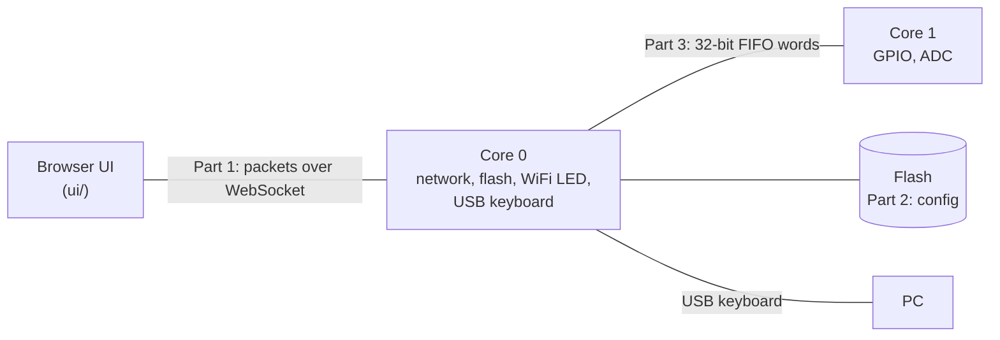
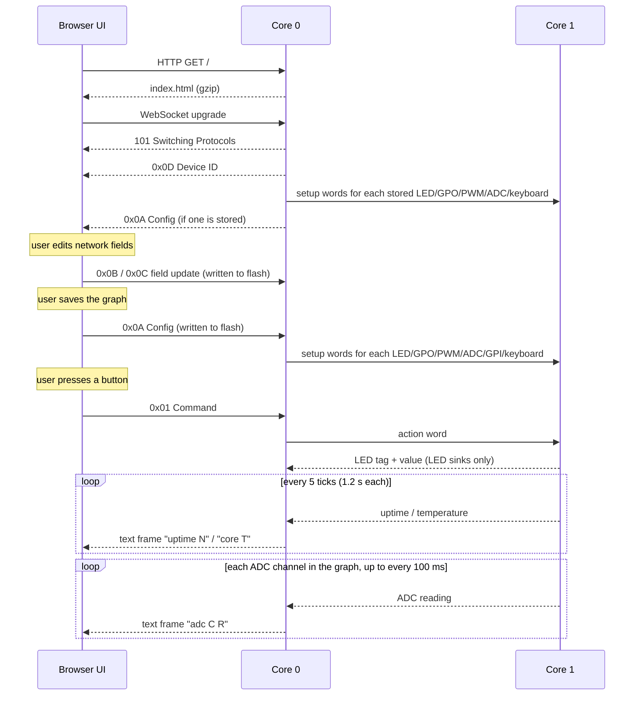
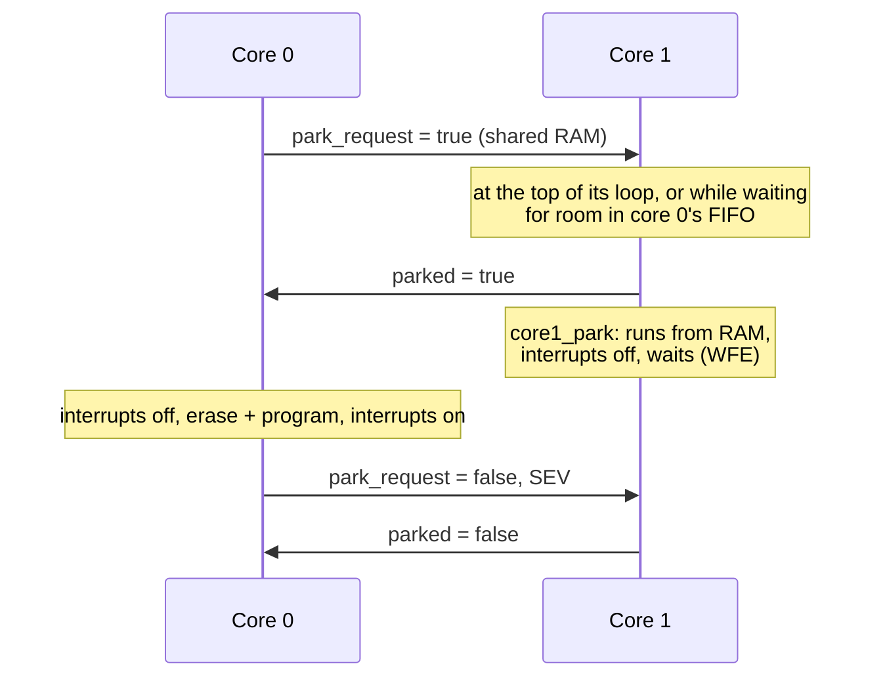

# neoGraph Protocol Reference

This document describes how the parts of neoGraph talk to each other, **as the code
behaves today**. Where the behaviour is surprising or wrong, it is described as-is
and listed under [Known issues](#known-issues).



| Part | What it covers | Code |
|---|---|---|
| [1. Transport](#part-1-transport-ui--hw) | Packets between the browser UI and the device | `src/websockets.c`, `src/tcpserver.c`, `ui/content/network.js` |
| [2. Config model](#part-2-config-model) | Messages, element types, the graph, networking, flash storage | `src/config.c`, `ui/content/graph.js`, `ui/content/components/` |
| [3. Inter-core FIFO](#part-3-inter-core-fifo-core-0--core-1) | Words between the two RP2350 cores | `src/hwman.c`, `src/main.c`, `src/config.c` |
| [USB keyboards](#usb-keyboards) | Keystrokes typed to the PC the device is plugged into | `src/keyboard.c`, `src/usb_descriptors.c`, `ui/content/components/keyboard.js` |

## Conventions

- **Byte order.** Every multi-byte number is big endian.
- **Hex.** Bytes are written as two hex digits (`0A`), FIFO words as eight (`80000200`).
- **Status.** Tables mark each entry **Implemented**, **Partial** (some of it works) or
  **Reserved** (the number is allocated but no code sends or handles it).
- **Constants.** Every number named here has a constant in
  [`src/protocol.h`](src/protocol.h), mirrored in
  [`ui/content/protocol.js`](ui/content/protocol.js). Use the constants, not the numbers.
- **Examples are tested.** Every `hex example=…` and `fifo example=…` block in this file
  is extracted by `make test` and checked (see
  [Keeping this document honest](#keeping-this-document-honest)). In those blocks,
  `#` starts a comment.

---

## Part 1: Transport (UI ↔ HW)

### Connection

The device runs one TCP server on **port 80**.

- A plain HTTP request on any path returns the UI: one gzip-compressed HTML page.
- A request carrying `Upgrade: websocket` and `Connection: Upgrade` is upgraded to a
  WebSocket, on any path. The UI connects to `ws://<device host>`.

On the WebSocket:

- **Binary frames** carry one packet each (below).
- **Text frames** carry telemetry from the device (see [Telemetry](#telemetry-text-frames)).
- Ping is answered with pong, and close closes the connection.

### Session



### Packet header

| Byte | Field | Notes |
|---|---|---|
| 0 | Packet type | See the table below |
| 1–2 | Payload length | Bytes after the header, big endian |
| 3… | Payload | A sequence of [messages](#message-header), except for 0x0D |

### Packet types

| Type | Constant | Direction | Payload | Status |
|---|---|---|---|---|
| `01` | `PKT_COMMAND` | UI → HW | Messages | Implemented |
| `02` | `PKT_DATA_VALUE` | — | — | Reserved |
| `0A` | `PKT_CONFIG` | UI ↔ HW | Messages | Implemented |
| `0B` | `PKT_UPDATE_CONFIG` | UI → HW | One message | Implemented |
| `0C` | `PKT_UPDATE_SECRET` | UI → HW | One message | Implemented |
| `0D` | `PKT_DEVICE_ID` | HW → UI | 8 raw bytes | Implemented |

The device sends no reply or acknowledgement to any packet.

#### `0D` Device ID

Sent by the device immediately after the WebSocket handshake. The payload is the
8-byte unique board ID (the DID). The UI uses it to find its own device among the
`B0` device elements of the config that follows.

```hex example=device-id
0D 00 08                    # Device ID, 8 bytes
BD FC EA C1 4E 1E 79 4D     # DID
```

#### `0A` Config

The full configuration: networking elements and the graph. The same packet,
header included, is what the device stores in flash (see [Storage](#storage)).

- **HW → UI.** Sent on connect, after `0D`, if flash holds a config. The UI
  rebuilds its graph from it (see [Restoring the graph](#restoring-the-graph)).
- **UI → HW.** Sent when the user saves the graph. The device writes the whole
  packet to flash, then sends setup words for each LED, GPO, PWM, ADC and GPIO input element to core 1.

[Part 2](#part-2-config-model) describes the payload; [The graph](#the-graph) has a
full example.

#### `01` Command

Sent by the UI when the user operates a UI input. Each message names the element
that was operated, with the values of its outputs as the payload.

| Message byte | Field | Notes |
|---|---|---|
| 0 | Message type | The type of the operated element: `10` button, `12` slider or `13` 2D slider |
| 1 | Flags | `00` |
| 2–3 | Element ID | The operated element |
| 4 | Payload length | The element's number of outputs: `01`, or `02` for a 2D slider |
| 5… | Values | One byte per output, in output order, each a fraction of full scale: `00` = 0 to `FF` = 1 (`VALUE_FULL`) |

**Values** run from 0 to 1, sent as one byte, `round(value × 255)`:

- **Button:** `00` released / `FF` pressed. A toggle button changes on each click; a
  momentary one (`BUTTON_MOMENTARY`) sends `FF` when pressed and `00` when let go.
- **Slider:** its position, `00`–`FF` (shown as 0.00–1.00). Dragging sends a command
  each time the byte changes.
- **2D slider:** X, then Y (see [2D sliders](#2d-sliders)). Dragging sends a command,
  with both values, each time either byte changes.

Outputs read the value the same way: an LED or GPO is on from `80` (`VALUE_HALF`, about
0.5) up. A PWM maps the value onto its duty cycle or frequency, whichever that input
drives (see [Control payloads](#control-payloads)).

For each message, core 0 sends one [action word](#core-0--core-1) to core 1 per
payload byte: byte *i* is the new value of the element's output *i*. Bytes after the
first `FIFO_OUTPUTS_MAX` (32) are ignored.

```hex example=command-button
01 00 06                    # Command, 6 bytes
10 00 00 01 01  FF          # button n1 → pressed, value 1
```

```hex example=command-slider
01 00 06                    # Command, 6 bytes
12 00 00 04 01  BF          # slider n4 → value 0.75
```

```hex example=command-slider-2d
01 00 07                    # Command, 7 bytes
13 00 00 06 02  FF 80       # 2D slider n6 → X 1, Y 0.5
```

#### `0B` Update config field, `0C` Update secret field

Change one field of a networking element without resending the whole config. The
payload is one `B0`–`B3` message (see [Networking](#networking)).

The device looks through the stored messages for one with the **same type, element
ID and field ID** (first payload byte), and replaces that message with the new one.
`0B` edits the config store; `0C` edits the secrets store.

- **`0B` adds a field** the device or network doesn't have yet (a `B1` or `B3`): the
  message goes after the element's last message, so fields added later, such as
  the [addresses](#network-addresses), can be set on a device configured before them.
  `0C` only replaces.
- **A password is never stored by `0B`:** the config store is sent to the UI.
- If the element isn't stored (`0B`) or no stored message matches (`0C`), or the
  result would not fit its flash region, nothing changes, and nothing is reported.
- The UI applies each `0B` to its copy of the config too, so saving the graph, which
  sends the networking messages back, keeps the change.
- The change is only written to flash. Networking reads it at the next boot.

```hex example=update-ssid
0B 00 08                    # Update config field, 8 bytes
B3 00 00 00 03  02 58 59    # network 0, field SSID = "XY"
```

```hex example=update-options
0B 00 07                    # Update config field, 7 bytes
B2 00 00 00 02  00 00       # network 0, field options = 0 (access point)
```

```hex example=update-ap-address
0B 00 0A                    # Update config field, 10 bytes
B3 00 00 00 05  04 0A 00 00 01   # network 0, field access point address = 10.0.0.1
```

```hex example=update-password
0C 00 0E                    # Update secret field, 14 bytes
B3 00 00 00 09  03 6E 65 77 70 61 73 73 31   # network 0, field password = "newpass1"
```

### Telemetry text frames

Core 0 forwards core 1's [telemetry words](#core-1--core-0) to the most recently
connected client as WebSocket text frames:

| Text | Meaning |
|---|---|
| `uptime N` | Uptime in 1.2 s ticks (integer) |
| `core T` | Chip temperature in °C, two decimals |
| `adc C R` | A reading of ADC channel C (0–2): R from 0 to 4095 (`ADC_RAW_FULL`, 3.3 V) |
| `gpi P S` | The state of the GPIO input on pin P: S is 1 on, 0 off (after its "On when") |

The UI hands `core T` to the [core temperature](#core-temperature) nodes, `adc C R`
to the [ADC](#adc-inputs) nodes on channel C, `gpi P S` to the
[GPIO input](#gpio-inputs) node on pin P, and ignores `uptime N`.

### Limits

| Limit | Value | Where |
|---|---|---|
| Config packet | 4096 bytes including the packet header (`PKT_CONFIG_MAX`). The UI refuses to save a bigger graph, and the device refuses to store one. | `PKT_CONFIG_MAX`, `FLASH_SIZE` |
| Received frame | 4110 bytes including the WebSocket header (`WS_RX_BUF`: one frame carrying the largest packet). A frame may span TCP segments, and a segment may hold several frames; a bigger frame closes the connection. Fragmented messages (continuation frames) are not supported. | `handle_websocket_msg` |
| Sent frame | 65535 bytes, and no more than lwIP's free send buffer (`TCP_SND_BUF`, 17520 bytes) | `send_websocket_frame` |
| UI page | No limit: it is streamed from flash one segment at a time as the browser acknowledges it | `send_page` |
| Stored secrets | 256 bytes | `SECURE_FLASH_SIZE` |
| Clients | The most recent connection only receives telemetry | `tcp_server_accept` |

---

## Part 2: Config model

### Message header

Every packet payload except `0D` is a sequence of messages:

| Byte | Field | Notes |
|---|---|---|
| 0 | Message type | Which kind of element; see [Element types](#element-types) |
| 1 | Flags | Bit 0 `MSG_FLAG_OUTPUT`: the payload's [source references](#source-references) name an output. Other bits are 0. |
| 2–3 | Element ID | Big endian |
| 4 | Payload length | Bytes after this header, 0–255 |
| 5… | Payload | Depends on the type |

### Element IDs

- **Control elements** (`00`–`3F`) get their IDs from the UI, counting from 1 on
  each page load. In the graph a node shows its ID as `n<ID>`.
- **Networking elements** (`B0`–`B3`) have their own IDs. The device and network
  created on first boot both have ID 0.
- **Labels, positions and wires** (`A0`–`A2`) take the ID of the control element
  they describe (see [Labels, positions and wires](#labels-positions-and-wires)).
- IDs are unique within each of those groups, not across them.
- **ID 0 in a source reference means "not connected"**, so a control element never
  has ID 0.

### Source references

An output names the input wired to it with a **source reference**: which element,
and which of its outputs. Most sources have one output, 0; a
[2D slider](#2d-sliders) has two, X (0) and Y (1).

| Message flags | Reference | Bytes |
|---|---|---|
| `MSG_FLAG_OUTPUT` (`01`) | The element ID, then its output | 3 |
| `00` | The element ID; its output is 0 | 2 |

- **The UI writes every reference with its output:** LED, GPO, PWM, USB keyboard and
  plot messages, and a PWM's `A2` wires, have the flag set.
- **Configs saved before sources had several outputs** have 2-byte references and the
  flag clear. The device and the UI still read them, as output 0, and the next save
  writes them with outputs. A `legacy-config` example is below.
- **Not connected** is ID 0, output 0.
- The payload tables below give the bytes with the flag set.

```hex example=legacy-config
0A 00 0C                                        # Config, 12 bytes
10 00 00 01 00                                  # button n1
20 00 00 02 02  00 01                           # LED n2 ← n1 (output 0), saved without outputs
```

### Element types

Control types use bits 4 and 5 of the type byte:

```text
  7   6   5   4   3   2   1   0
+---+---+---+---+---------------+
| 0 | 0 | H | I |   subtype     |
+---+---+---+---+---------------+
H (MSG_HW_BIT, 0x20):    0 = UI element, 1 = hardware element
I (MSG_INPUT_BIT, 0x10): 0 = output,     1 = input
```

| Type | Constant | Element | Status |
|---|---|---|---|
| `00` | `MSG_UI_GAUGE` | UI output gauge | Reserved |
| `01` | `MSG_UI_INDICATOR` | UI output indicator: a light | Implemented |
| `02` | `MSG_UI_GRAPH` | UI output graph: a plot | Implemented |
| `10` | `MSG_UI_BUTTON` | UI input button | Implemented |
| `11` | `MSG_UI_SWITCH` | UI input switch | Reserved |
| `12` | `MSG_UI_SLIDER` | UI input slider | Implemented |
| `13` | `MSG_UI_SLIDER_2D` | UI input 2D slider: two outputs, X and Y | Implemented |
| `14` | `MSG_UI_MULTI_SLIDER` | UI input multi slider | Reserved |
| `15` | `MSG_UI_DIAL` | UI input dial | Reserved |
| `16` | `MSG_UI_TIMER` | UI input timer | Reserved |
| `20` | `MSG_HW_LED` | HW output: onboard LED | Implemented |
| `21` | `MSG_HW_GPO` | HW output: GPIO pin | Implemented |
| `22` | `MSG_HW_PWM` | HW output: PWM pin | Implemented |
| `23` | `MSG_HW_KEYBOARD` | HW output: a keystroke typed to the PC over USB | Implemented |
| `30` | `MSG_HW_CORE` | HW input: core temperature | Implemented |
| `31` | `MSG_HW_GPI` | HW input: GPIO pin | Implemented |
| `32` | `MSG_HW_ADC` | HW input: ADC | Implemented |
| `A0` | `MSG_STRING` | String: a node's label | Implemented |
| `A1` | `MSG_LAYOUT` | A node's position in the graph | Implemented |
| `A2` | `MSG_WIRE` | The shape of the wire into an output | Implemented |
| `B0` | `MSG_DEVICE` | Device | Implemented |
| `B1` | `MSG_DEVICE_FIELD` | Device field | Implemented |
| `B2` | `MSG_NETWORK` | Network | Implemented |
| `B3` | `MSG_NETWORK_FIELD` | Network field | Implemented |

### Control payloads

| Element | Payload length | Payload |
|---|---|---|
| `10` Button | 0–1 | Byte 0, bit 0 (`BUTTON_MOMENTARY`): 0 = each click toggles it, 1 = it is on while held. Other bits are 0. The UI leaves the byte out for a toggle button (as buttons saved before it existed), and sends `01` for a momentary one. The device ignores button messages in a config. |
| `12` Slider | 1 | Byte 0, bit 0 (`SLIDER_VERTICAL`): 0 = horizontal (UI default), 1 = vertical. Other bits are 0. The device ignores slider messages in a config: the orientation is for the Command view. |
| `13` 2D slider | 1–4 | Byte 0, bit 0 (`SLIDER_RETURN`): 0 = it stays where it is let go (UI default), 1 = it returns home. Bits 1–2 (`SLIDER_EASE_MASK`), how it returns: `SLIDER_EASE_IMMEDIATE` (`00`), `SLIDER_EASE_LINEAR` (`02`, UI default) or `SLIDER_EASE_SIGMOID` (`04`). Other bits are 0. Byte 1: the return speed, 1–255 % of its range per second (UI default 100); without it, the return is immediate. Bytes 2–3: its home, X then Y as values, `00`–`FF` (UI default `80 80`, the centre); without them, the centre. The device uses only the home: it drives the slider's outputs there (`slider_2d_home`). See [2D sliders](#2d-sliders). |
| `01` Light | 3 | Bytes 0–2: source reference (0 = not connected). The device ignores light messages in a config: the light is drawn in the browser (see [Lights](#lights)). |
| `02` Plot | 4–20 | Bytes 0–2: source reference (0 = not connected) · byte 3: time window, 1–255 s (UI default 10) · bytes 4…: the unit, 0–16 bytes of UTF-8 text; none (the UI default) shows the source's unit. The device ignores plot messages in a config: the plot is drawn in the browser (see [Plots](#plots)). |
| `30` Core temperature | 0 | None. The device ignores it in a config: the temperature is sent as telemetry whatever the graph (see [Core temperature](#core-temperature)). |
| `31` GPIO input | 2 | Byte 0: the GPIO pin, a [usable](#gpio-pins) one (UI default 3). Byte 1: options; bits 0–1 (`GPI_PULL_MASK`) the pin's pull, `GPI_PULL_NONE` (0), `GPI_PULL_UP` (1) or `GPI_PULL_DOWN` (2, UI default); bit 2 (`GPI_INVERT`): 0 = on while the pin is high (UI default), 1 = on while it is low. Other bits are 0. See [GPIO inputs](#gpio-inputs). |
| `32` ADC | 1 | Byte 0: the ADC channel, 0 to `ADC_CHANNELS` − 1 (2), on GPIO `ADC_PIN_FIRST` (26) + channel (UI default 0). See [ADC inputs](#adc-inputs). |
| `20` LED | 3 | Bytes 0–2: source reference (0 = not connected) |
| `21` GPO | 4 | Bytes 0–2: source reference (0 = not connected) · byte 3: GPIO pin, a [usable](#gpio-pins) one (UI default 1) |
| `22` PWM | 17 | See below |
| `23` USB keyboard | 6, or 5–68 | Bytes 0–2: source reference (0 = not connected) · byte 3: `KEYBOARD_COMBO` (0) or `KEYBOARD_TEXT` (1) · then a combo's HID modifier bits and HID key, or 1–64 characters of text. See [USB keyboards](#usb-keyboards). |

Without `MSG_FLAG_OUTPUT` each [source reference](#source-references) is a byte
shorter, and so is everything after it: an LED is 2 bytes, a GPO 3, a PWM 15, a plot
3–19 and a keyboard 5 or 4–67. `pwm_payload_read` and `keyboard_payload_valid` in
`src/protocol.h` read either.

#### GPIO pins

A GPO or PWM may use **GPIO 0–22 and 26–28**, the pins on the Pico 2 W's header
(`PIN_USABLE_MASK`, bit n for GPIO n). GPIO 23, 24, 25 and 29 drive the WiFi chip:
changing them cuts the device off the network.

- The UI offers only the usable pins, and keeps the default pin when a config names
  another one.
- **One node per pin.** A GPO, PWM or GPIO input is offered only the pins no other node
  uses, and an ADC only the channels whose pin (GPIO 26–28) no other node uses. A new
  node takes its default pin (GPO 1, PWM 2, GPIO input 3) if it is free, otherwise the
  lowest free one; a new ADC the first free channel.
- Core 1 doesn't set up a GPO or PWM on another pin, and logs that it skipped it.

A PWM has two parameters, its **duty cycle** and its **frequency**. Each is constant, or
follows an input: a source element whose value maps linearly onto it, 0 → min and
1 → max (min may be above max, which inverts the input). The payload:

| Bytes | Field | Range (UI default) |
|---|---|---|
| 0–2 | Duty source reference, 0 = none | |
| 3 | GPIO pin | A [usable](#gpio-pins) one (2) |
| 4–5 | Constant frequency, Hz | `PWM_FREQ_MIN` (10)–65535 (1000) |
| 6 | Options: bit 0 `PWM_DUTY_INPUT`, bit 1 `PWM_FREQ_INPUT`: a set bit makes that parameter follow its source. Bit 2 `PWM_FREQ_LOG`: a frequency that follows its source goes from min to max logarithmically, not linearly. Other bits 0. | (0) |
| 7 | Constant duty, % | 0–`PWM_DUTY_MAX` (100) (50) |
| 8 | Duty at input 0 (min), % | 0–100 (0) |
| 9 | Duty at input 1 (max), % | 0–100 (100) |
| 10–12 | Frequency source reference, 0 = none | |
| 13–14 | Frequency at input 0 (min), Hz | 10–65535 (100) |
| 15–16 | Frequency at input 1 (max), Hz | 10–65535 (10000) |

- **A constant parameter is constant:** a PWM whose duty cycle and frequency are both
  constant runs from setup and ignores its inputs.
- **Only floating sources** the device has (a slider, a 2D slider's X or Y, or an ADC)
  can drive a PWM; see [Wire types](#wire-types).
- **A logarithmic frequency** (`PWM_FREQ_LOG`) is min × (max / min)^value: each step
  of the input multiplies it by the same factor, so a slider spends as long on
  100–1000 Hz as on 1–10 kHz. With 100 and 10000 Hz, 0.5 gives 1 kHz (5050 Hz when
  linear).
- **One source may drive both** parameters; the PWM then has one wire. The X and Y of
  one 2D slider are two sources, with a wire each.
- **Until a source sends a value** it reads 0, so a parameter from an input starts at
  its min.
- **Every field is always sent,** so switching a parameter between constant and input
  in the UI keeps its other values.

A node's label, position and incoming wire shape are separate messages (see
[Labels, positions and wires](#labels-positions-and-wires)).

### The graph

The graph editor's nodes are control elements, and its wires are **source
references**. A wire is not a message of its own:

- An output stores a [source reference](#source-references) to the input wired to it:
  an LED, GPO or plot its one source, a PWM the source of its duty cycle and of its
  frequency.
- An input (button, slider) can feed many outputs from each of its outputs; it stores
  nothing about them.

#### Wire types

Every input and output is **boolean** or **floating**, and a wire joins only the same
type:

| Type | Sources | Outputs | Values |
|---|---|---|---|
| Boolean | `10` button, `31` GPIO input | `20` LED, `21` GPO, `23` USB keyboard, `01` light | 0 or 1 (`00` / `FF`) |
| Floating | `12` slider, `13` 2D slider (X and Y), `32` ADC, `30` core temperature | `22` PWM, `02` plot | A slider, or a 2D slider's X or Y, 0 to 1 (`00`–`FF`); an ADC in volts in the browser, 0 to 1 on the device; the core temperature in °C |

The core temperature's values reach only the browser, so it drives a plot but not a
PWM. An ADC's are on the device, so it drives both; so are a GPIO input's, which drives
an LED, GPO or USB keyboard on the device and a light in the browser. The UI only draws wires between matching types, and drops mismatched source references
when it restores a config (configs saved before types were checked may hold them).

When the user saves, the UI sends a `0A` config whose payload is:

1. the networking messages (`B0`–`B3`) of the last config the device sent, byte
   for byte, then
2. for each graph node, in the order the nodes were created: its control message,
   its label (`A0`), its position (`A1`) and, if a wire comes into it, the wire's
   shape (`A2`).

Graph messages in the device's previous config are dropped, so a save replaces the
stored graph rather than adding to it.

Example: the demo graph with button `n1` wired to LED `n2` and to GPO `n3` on pin 1,
with `n1` and `n2` renamed, then a PWM `n4` added on pin 2 at a constant 1000 Hz, and
a slider `n5` "Level" wired to the PWM's duty cycle (0 % at 0, 100 % at 1), saved
against the first-boot config below.

```hex example=save-config
0A 00 EC                                        # Config, 236 bytes
# networking, kept from the device's config
B0 00 00 00 09  00 BD FC EA C1 4E 1E 79 4D      # device 0: DID
B1 00 00 00 05  01 4C 38 53 47                  # device 0: name "L8SG"
B1 00 00 00 03  02 00 00                        # device 0: network 0
B2 00 00 00 02  00 01                           # network 0: options = join
B3 00 00 00 05  01 4C 38 53 47                  # network 0: name "L8SG"
B3 00 00 00 04  02 4C 52 58                     # network 0: SSID "LRX"
# the graph
10 00 00 01 00                                  # button n1
A0 00 00 01 05  53 74 61 72 74                  #   label "Start"
A1 00 00 01 04  FF 38 FF D8                     #   at (-200, -40)
20 01 00 02 03  00 01 00                        # LED n2 ← n1
A0 00 00 02 0C  50 6F 6D 70 65 20 C3 A0 20 65 61 75   #   label "Pompe à eau"
A1 00 00 02 04  00 64 00 28                     #   at (100, 40)
A2 00 00 02 04  F5 62 75 62                     #   wire from n1: 345.1° at n1, 165.1° at n2
21 01 00 03 04  00 01 00 01                     # GPO n3 ← n1, pin 1
A0 00 00 03 03  47 50 4F                        #   label "GPO"
A1 00 00 03 04  00 C8 00 00                     #   at (200, 0)
A2 00 00 03 04  FB F0 7B F0                     #   wire from n1: 354.3° at n1, 174.3° at n3
22 01 00 04 11  00 05 00 02 03 E8 01            # PWM n4: duty ← n5, pin 2, 1000 Hz, duty from input
                32 00 64  00 00 00 00 64 27 10  #   duty 50 %, 0–100 %; no frequency source, 100–10000 Hz
A0 00 00 04 03  50 57 4D                        #   label "PWM"
A1 00 00 04 04  00 C8 00 78                     #   at (200, 120)
A2 01 00 04 07  00 00 80 00 00 05 00            #   wire from n5: 0° at n5, 180° at n4
12 00 00 05 01  00                              # slider n5, horizontal
A0 00 00 05 05  4C 65 76 65 6C                  #   label "Level"
A1 00 00 05 04  FF 38 00 78                     #   at (-200, 120)
```

### Restoring the graph

When a config arrives, the UI rebuilds the graph from it:

- **If the config has no control messages** (a first-boot config), the UI keeps the
  graph it has, so a new device starts from the built-in demo graph.
- **Otherwise the graph is replaced.** Each control message of a type the UI knows
  (`10` button, `12` slider, `13` 2D slider, `01` light, `02` plot, `20` LED, `21` GPO, `22` PWM,
  `23` USB keyboard, `30` core temperature, `31` GPIO input, `32` ADC) becomes a node with the message's ID. If an ID
  appears more than once, as in configs saved by older UIs, the last message wins.
- **Position:** from the node's `A1` message. Without one, nodes are stacked: inputs
  at x = −200, outputs at x = 150, 100 apart from y = −100.
- **Settings and label:** a button takes its action (toggle or momentary), a slider its orientation, a 2D slider its home and whether and how it returns there, a plot its time window and unit, an ADC its channel, a GPIO input its pin, pull and when it is on, a GPO its pin, a USB keyboard its keystroke, and a PWM its
  pin and the settings of its duty cycle and frequency, from the message (an invalid value keeps the default), and a node takes the
  label from its `A0` message.
- **Wires:** one for each source reference of an output that names an output of a
  restored node of the output's [type](#wire-types): an LED's, GPO's, USB keyboard's or light's button or GPIO input, a plot's slider, 2D slider, ADC or core temperature, and the sliders, 2D sliders or
  ADCs of a PWM's parameters that follow an input. A reference without an output
  (a config saved before them) is to output 0. Each wire is shaped by its `A2` message; without one,
  the wire is drawn straight between the nodes.
- **Afterwards:** the Command view is rebuilt from the restored inputs, and new nodes
  get IDs above the highest restored one.

### Plots

A plot (`02`) draws the value of the floating source wired to it in the Command view,
over its time window, newest on the right. Pointing at the plot reads the value at
that time.

- **Any number.** A plot isn't limited to the 0–1 of a command value: its value axis
  fits the values the window shows, with gridlines at round numbers. A value that is
  not finite leaves a gap.
- **The values come from the source in the browser.** A source hands each new
  value to the plots wired to it (`emit` in `ui/content/components/parent.js`); a
  slider does so when it sends its [command](#01-command), and a
  [core temperature](#core-temperature) when its telemetry arrives. Nothing is sent for a
  plot, and the device stores its message but sends nothing to core 1 for it.
- **The plot holds each value until the next.** A slider sends a value only when it
  changes, so the trace is a step line. Wiring a plot starts it from the slider's
  current value; taking the wire out ends the trace.
- **The history lives in the page.** It is lost on reload, and kept for the largest
  window (255 s), so a wider window shows what was already received.
- **The unit** is shown after the value. By default it is the source's: V for an
  [ADC](#adc-inputs), °C for a [core temperature](#core-temperature), none for a
  slider. A unit set in the plot's settings (up to 16 bytes) overrides it, and is
  saved in the plot's message; clearing it, or setting "auto", goes back to the
  source's.

### Lights

A light (`01`) shows in the Command view whether the boolean signal wired into it, a
[button](#control-payloads), is on or off: a lamp, green while it is on, with the
label and "On" or "Off" below it.

- **On from `VALUE_HALF`,** as an LED: a button's 1 lights it, its 0 puts it out.
- **The values come from the source in the browser**, as a [plot's](#plots) do: a
  button hands each value it sends to the lights wired to it. Nothing is sent for a
  light, and the device stores its message but sends nothing to core 1 for it.
- **Wiring it** shows the source's current state; without a source it shows `–`.

A momentary button `n1` wired to a light `n2`:

```hex example=light-config
0A 00 0E                                        # Config, 14 bytes
10 00 00 01 01  01                              # button n1, momentary
01 01 00 02 03  00 01 00                        # light n2 ← n1
```

```fifo example=light-config
C0000000                    # clean setup; the button and light are skipped
```

### Core temperature

A core temperature node (`30`) is a floating source whose value is the chip's
temperature in °C, from the `core T` [telemetry text frames](#telemetry-text-frames).
The Command view shows it on a tile, and a plot wired to it draws it.

- **Nothing new on the device.** Core 1 measures the temperature every 5 ticks (6 s)
  whatever the graph, and core 0 sends it to the most recent client. The UI hands
  each value to every core temperature node, which hands it to its plots.
- **Until the first frame** the node has no value: its tile shows `–`, and a plot
  wired to it draws nothing.
- **Browser only.** The device never sees these values as a source, so a core
  temperature can't drive a PWM; the UI refuses that wire.

### GPIO inputs

A GPIO input node (`31`) is a boolean source: one of the device's header pins, read as
on or off. In the Command view a tile shows its state, On or Off (`–` until the first
reading), and the [lights](#lights) wired to it show it too.

- **Pull and polarity.** The pin's pull is none, up or down. "On when" Low
  (`GPI_INVERT`) makes it on while the pin is low: a switch to ground with the pull up.
  The default, pull down and on while high, suits a switch to 3.3 V.
- **On the device.** Core 1 reads the pin every 10 ms. A new state, held for 3 reads
  in a row (30 ms) so a bouncing switch changes it once, drives the outputs wired to
  the node directly, `FF` on and `00` off, as a button's command would: an LED, GPO or
  USB keyboard follows the pin without the browser (see
  [Core 1 behaviour](#core-1-behaviour)).
- **In the browser.** Core 1 reports each change, and the state every second, which
  core 0 sends as a `gpi P S` [telemetry text frame](#telemetry-text-frames). The UI
  hands it to the GPIO input node on that pin, which hands it to its lights. A browser
  that connects learns the state within a second.
- **After a save.** The device reads a pin once a saved config has a GPIO input on it,
  so a new node's tile shows `–` until the graph is saved.
- **The pin is the input's.** The UI doesn't offer it to another node (see
  [GPIO pins](#gpio-pins)), and core 1 refuses a GPO, PWM, ADC or other GPIO input on
  the same pin from an older config: the first setup on a pin wins (see
  [Known issues](#known-issues)).

A GPIO input `n1` on GPIO 3, pulled up and on while low (a switch to ground), driving
the onboard LED `n2` and a light `n3`:

```hex example=gpi-config
0A 00 17                                        # Config, 23 bytes
31 00 00 01 02  03 05                           # GPIO input n1 on GPIO 3: pull up, on while low
20 01 00 02 03  00 01 00                        # LED n2 ← n1
01 01 00 03 03  00 01 00                        # light n3 ← n1
```

### ADC inputs

An ADC node (`32`) is a floating source: one of the device's analog inputs, ADC0 to
ADC2 on GPIO 26 to 28. In the browser its value is the reading in volts, 0 to 3.3
(1.3 V reads 1.3), and its unit is V. The Command view shows it on a tile, and a plot
wired to it draws it.

- **Two scales.** On the device the reading drives outputs as a fraction of 3.3 V, 0
  to 1, as a slider's value does: 1.3 V puts a PWM's duty 39 % of the way from its
  min to its max.

- **On the device.** Core 1 samples each channel that has an ADC node and drives the
  outputs wired to the node directly, as a command from the browser would, so a
  potentiometer can drive a PWM without the browser (see
  [Core 1 behaviour](#core-1-behaviour)).
- **In the browser.** Core 1 also reports each channel's reading, which core 0 sends as
  an `adc C R` [telemetry text frame](#telemetry-text-frames). The UI hands it to
  every ADC node on that channel, which hands it to its plots.
- **After a save.** The device samples a channel once a saved config has an ADC node
  on it, so a new node's tile shows `–` until the graph is saved.
- **ADC3** (GPIO 29) is the WiFi chip's clock on the Pico 2 W, so it isn't offered.
- **The pin is the ADC's.** The UI doesn't offer it to another node (see
  [GPIO pins](#gpio-pins)), and core 1 refuses a GPO, PWM or GPIO input on the same
  pin from an older config: the first setup on a pin wins (see
  [Known issues](#known-issues)).

An ADC on ADC1 (GPIO 27) driving a PWM's duty cycle, and drawn on a plot:

```hex example=adc-config
0A 00 25                                        # Config, 37 bytes
32 00 00 01 01  01                              # ADC n1 on ADC1
22 01 00 02 11  00 01 00 02 03 E8 01            # PWM n2: duty ← n1, pin 2, 1000 Hz, duty from input
                32 00 64  00 00 00 00 64 27 10  #   duty 50 %, 0–100 %; no frequency source, 100–10000 Hz
02 01 00 03 04  00 01 00 0A                     # plot n3 ← n1, 10 s
```

### 2D sliders

A 2D slider (`13`) is a UI input with two floating outputs: **X** (output 0) and **Y**
(output 1). In the Command view it is a square pad with a puck; X runs from 0 at the
left to 1 at the right, and Y from 0 at the bottom to 1 at the top. Anything a slider
drives, either output can drive.

- **One command, both values.** Dragging the puck, or the arrow keys (Shift: ten steps),
  sends a [command](#01-command) with X then Y each time either byte changes. Core 0
  turns it into an action word for each output.
- **Wires name their output.** Each wire from a 2D slider carries its output in its
  [source reference](#source-references), and is labelled X or Y at the slider. New
  wires leave from the output picked in the slider's settings ("Wire from"); once a
  wire leaves from one, the setting turns to the other, so wiring X then Y takes no
  trip to the settings.
- **Home** (bytes 2–3, "Home X" and "Home Y" in the settings, 0 to 1): where the puck
  starts, and where it returns to. The UI default is the centre, `80 80`
  (`VALUE_HALF`, about 0.5 each).
- **Starting at home.** Each time core 0 applies a config (a save, and each connect),
  after the setup words it sends the action words for each 2D slider's home, so the
  outputs wired to it start there rather than at 0, as the puck does in the browser.
- **Let go** (`SLIDER_RETURN` clear), it stays where it is. With "Return home" set,
  letting go of the puck, or of an arrow key, takes it back home, like a joystick
  springing back. How it gets there is its return shape:

  | Return | Bits 1–2 | Moves |
  |---|---|---|
  | Immediate | `SLIDER_EASE_IMMEDIATE` | Straight home, in one command |
  | Linear | `SLIDER_EASE_LINEAR` | In a straight line at a steady speed |
  | Sigmoid | `SLIDER_EASE_SIGMOID` | In a straight line, speeding up then slowing down: a fraction *u* of the way through the time, it is 3*u*² − 2*u*³ of the way there |

  A linear or sigmoid return takes the distance over the return speed (byte 1, % of
  the range per second, on average): at 100 a corner takes about 0.7 s. It sends a
  command each time a value's byte changes on the way. Touching the pad, or an arrow
  key, stops the return where it is.

A 2D slider `n1` whose home is X 0.25, Y 0.75, and that returns there, driving a PWM's
duty cycle from its X and frequency from its Y:

```hex example=slider-2d-config
0A 00 1F                                        # Config, 31 bytes
13 00 00 01 04  03 64 40 BF                     # 2D slider n1, returns linearly at 100 %/s to (0.25, 0.75)
22 01 00 02 11  00 01 00 02 03 E8 03            # PWM n2: duty ← n1 X, pin 2, 1000 Hz, both from inputs
                32 00 64  00 01 01 00 64 27 10  #   duty 50 %, 0–100 %; frequency ← n1 Y, 100–10000 Hz
```

### USB keyboards

A USB keyboard node (`23`) types a keystroke to the PC the device is plugged into,
over its USB port, once each time its input goes on. Its input is boolean: a
[button](#control-payloads).

- **The USB port is two devices.** The PC sees a keyboard and, as before, the serial
  console that `printf` writes to. Both come up whatever the graph; the keyboard
  types only when a keyboard node's input goes on.
- **Once per press.** The keystroke is typed when the input goes from off to on
  (`VALUE_HALF` and up), and not again until it has gone off. A toggle button types on
  every other click, when it turns on; a momentary button types on every press, so
  it is the one to wire to a keyboard.
- **A key combo** (`KEYBOARD_COMBO`) presses one key while holding modifiers, then
  lets them all go: Ctrl+Alt+Delete, Win+L, F13. Byte 3 is the HID modifier bits,
  byte 4 the HID key (usage page 7), or 0 for the modifiers alone. The UI offers left
  Ctrl `01`, Shift `02`, Alt `04` and Win `08` (Command on a Mac, Super on Linux), and
  letters, digits, punctuation, F1–F24, Enter, Escape, Backspace, Tab, Space,
  arrows, Insert, Delete, Home, End, Page Up and Down, Print Screen, Scroll Lock,
  Pause, Caps Lock and Menu.
- **Text** (`KEYBOARD_TEXT`) types 1 to `KEYBOARD_TEXT_MAX` (64) characters, one key
  at a time: printable ASCII (`20`–`7E`), tab (`09`, Tab) and newline (`0A`, Enter).
  Each character is typed as on a US keyboard: the PC turns the key into a character
  with its own layout, so on another layout some characters come out differently. In
  the UI's settings, Enter is written `\n`, Tab `\t` and a backslash `\\`.
- **Typing speed.** The PC reads a key down or up each millisecond, so 64 characters
  take about 130 ms. Keystrokes from several presses wait their turn, up to 8; more
  are dropped.
- **No PC, no keystroke.** A press while nothing is listening on USB (unplugged, a
  charger, the PC asleep) is dropped, and unplugging drops the keystrokes waiting, so
  nothing is typed later out of context.
- **On the device.** Core 0 keeps each node's keystroke (up to 16 nodes) and types it;
  core 1 tells it when (see [Core 1 behaviour](#core-1-behaviour)). A button in the
  browser reaches it as a command; a hardware input on core 1 would reach it without
  the browser.

A momentary button `n1` typing Ctrl+Alt+Delete, and a toggle button `n3` typing
`hello` and Enter:

```hex example=keyboard-config
0A 00 25                                        # Config, 37 bytes
10 00 00 01 01  01                              # button n1, momentary
23 01 00 02 06  00 01 00 00 05 4C               # keyboard n2 ← n1: combo, Ctrl+Alt, Delete
10 00 00 03 00                                  # button n3, toggle
23 01 00 04 0A  00 03 00 01 68 65 6C 6C 6F 0A   # keyboard n4 ← n3: text "hello\n"
```

### Labels, positions and wires

A node's label, position and incoming wire are each a message whose element ID is
the ID of the node it describes. The device stores them with the rest of the config and sends them
back on connect. It sends nothing to core 1 for them.

| Message | Payload |
|---|---|
| `A0` label | 1–255 bytes of UTF-8 text, not null-terminated |
| `A1` position | 4 bytes: x then y, each a signed 16-bit big-endian number in graph (SVG) units, rounded |
| `A2` wire | 4 bytes: the handle angle at the source end, then at the output end, each an unsigned 16-bit big-endian fraction of a full turn (1/65536), counter-clockwise on screen from pointing right. For a wire into a PWM, 7 bytes: the same, then the source reference, with `MSG_FLAG_OUTPUT` set (6 bytes in configs saved without outputs). |

- The UI saves a label and a position for every node, including unchanged defaults,
  and a wire shape for every wire. An LED or GPO has at most one incoming wire, so the
  output's ID identifies it; a PWM has up to two, told apart by their source references.
- The Settings view rejects a label longer than 255 bytes.
- Each node adds about 15 bytes plus its label to the config, and each wire 9 more.
  A config is at most 4096 bytes (see [Limits](#limits)): about 100 wired nodes with
  short labels, fewer with long ones.

### Networking

Four element types describe devices and networks. The payload of each starts with a
**field ID**, followed by the field's value:

| Byte | Field |
|---|---|
| 0 | Field ID |
| 1… | Field value (payload length − 1 bytes) |

- `B0` declares a **device** and `B2` declares a **network**. Their element ID is the
  device's or network's ID, and they carry one field.
- `B1` and `B3` set further fields on the device or network with the same element ID.
  Each message sets one field.

| Element | Field | Constant | Value | Store |
|---|---|---|---|---|
| `B0`/`B1` device | `00` DID | `FIELD_DEVICE_DID` | 8 bytes | config |
| | `01` name | `FIELD_DEVICE_NAME` | ASCII, up to 31 bytes | config |
| | `02` network | `FIELD_DEVICE_NETWORK` | 2-byte network ID | config |
| `B2`/`B3` network | `00` options | `FIELD_NETWORK_OPTIONS` | 1 byte, see below | config |
| | `01` name | `FIELD_NETWORK_NAME` | ASCII, up to 31 bytes | config |
| | `02` SSID | `FIELD_NETWORK_SSID` | ASCII, up to 31 bytes | config |
| | `03` password | `FIELD_NETWORK_PASSWORD` | ASCII, up to 31 bytes | **secrets** |
| | `04` access point address | `FIELD_NETWORK_AP_ADDRESS` | 4 bytes, IPv4 | config |
| | `05` fixed address | `FIELD_NETWORK_STATIC_ADDRESS` | 4 bytes, IPv4 | config |
| | `06` gateway | `FIELD_NETWORK_GATEWAY` | 4 bytes, IPv4 | config |

Network options, bit 0 (`NET_OPT_JOIN`): `0` = start an access point (with a DHCP
server) using the SSID and password; `1` = join an existing network. Other bits are
unused.

#### Network addresses

Address fields hold an IPv4 address as 4 bytes, most significant first
(`C0 A8 04 01` is 192.168.4.1). A network without the field, or with `00 00 00 00`,
hasn't set it. The UI shows the field for the mode the network is in; each mode keeps
its own.

- **Access point** (`04`): the device's address on its own network, and the gateway
  and DNS server its DHCP server hands out. The network is the address's /24; the
  DHCP server leases hosts `NET_LEASE_FIRST` (16) to 23 of it, so the access point
  can't take one of those, or .0 or .255. Not set: 192.168.4.1. Phones that join
  the access point open `http://<address>`.
- **Joining, fixed address** (`05`): the device joins with DHCP as before, then
  releases the lease and takes this address, keeping the lease's netmask. Not set:
  it keeps the DHCP address. The address must be free on that network: the device
  doesn't check.
- **Joining, gateway** (`06`): with a fixed address, the network's gateway. Not set:
  the one DHCP gave. The UI shows it only when a fixed address is set.
- **Usable addresses** (`net_address_usable` in `src/protocol.h`, `addressUsable` in
  the UI): unicast, not loopback (127), and not .0 or .255. The device ignores a field
  that isn't usable, and the UI refuses it.

At boot, the device finds the `B0` whose DID matches its own, reads that device's
fields, then reads the fields of the network it points to. It reads the config store
first and then the secrets store. The UI does the same with the DID from `0D`, and
does not read the password.

### Storage

The config and the secrets are each stored as a complete `0A` packet, header
included, at the end of flash:

| Region | Offset from end of flash | Size | Holds |
|---|---|---|---|
| Config | −4096 | 4096 bytes | Everything except passwords; sent to the UI on connect |
| Secrets | −4352 | 256 bytes | `B3` password fields; never sent to the UI |

On boot, if the config region does not start with `0A`, the device writes a default
config and default secrets:

- **Device 0**, with the board's DID. Its name is 4 characters derived from the DID:
  a letter, then three letters or digits.
- **Network 0**, with the same name, options = join, and SSID `LRX`.
- **Secrets**: a `B3` password field for network 0 with a fixed 8-character password
  (`build_secrets` in `src/config.c`).

```hex example=default-config
0A 00 3A                                        # Config, 58 bytes
B0 00 00 00 09  00 BD FC EA C1 4E 1E 79 4D      # device 0: DID
B1 00 00 00 05  01 4C 38 53 47                  # device 0: name "L8SG"
B1 00 00 00 03  02 00 00                        # device 0: network 0
B2 00 00 00 02  00 01                           # network 0: options = join
B3 00 00 00 05  01 4C 38 53 47                  # network 0: name "L8SG"
B3 00 00 00 04  02 4C 52 58                     # network 0: SSID "LRX"
```

---

## Part 3: Inter-core FIFO (core 0 ↔ core 1)

The RP2350's two cores share a pair of hardware FIFOs, one in each direction, that
carry 32-bit words.

- **Core 0** runs networking and flash, and drives the onboard LED. The LED is
  attached to the WiFi chip, which only core 0 talks to. It also runs USB: the
  serial console and the [USB keyboards](#usb-keyboards).
- **Core 1** owns the GPIO pins and the ADC.

### Core 0 → core 1

Every exchange starts with an **operation word**:

```text
 31 30 29 28       24 23                      8 7             0
+-----+--+-----------+-------------------------+---------------+
| op  |--| type&0x1F |       element ID        |      pin      |   setup
+-----+--+-----------+-------------------------+---------------+
| op  |--|  output   |       element ID        |     value     |   action
+-----+--+-----------+-------------------------+---------------+
```

| `op` | Constant | Sent by | Followed by |
|---|---|---|---|
| 1 | `FIFO_OP_CONTROL_ACTION` | `01` command, one per payload byte: the value of one output of the element. Also `0A` config and each connect, after the setup words: a 2D slider's home | Nothing |
| 2 | `FIFO_OP_SETUP` | `0A` config and on each connect, one per LED/GPO/PWM/ADC/GPI/keyboard message | For an LED, GPO, PWM or keyboard, one reference word; for a PWM, then a PWM word, a duty word, a second reference word and a frequency word. For an ADC, nothing: the low byte is its channel. For a GPIO input, the low byte is its pin, and a GPI options word follows: bits 7–0 its options (`fifo_gpi_options_word`) |
| 3 | `FIFO_OP_CLEAN_SETUP` | `0A` config and on each connect, once, before the setup words | Nothing |

A setup word carries the low 5 bits of the element type. Core 1 sets bit 5 on decode,
so it sees the hardware type: LED `20`, GPO `21`. An action word carries the output
in those bits instead, 0 to `FIFO_OUTPUTS_MAX` − 1 (31), and `fifo_action_word` and
`fifo_op_output` build and read it.

The **reference word** after a setup word carries the source reference, the source
element ID and its output:

```text
 31                      16 15             8 7             0
+-------------------------+----------------+---------------+
|    source element ID    |       0        |    output     |
+-------------------------+----------------+---------------+
```

After a PWM's reference word, which carries its duty source, come four words, as in the
[PWM payload](#control-payloads): the **PWM word** (constant frequency and options),
the **duty word** (duty cycles), a second **reference word** (the frequency source)
and the **frequency word** (frequency range):

```text
PWM word
 31                      16 15             8 7             0
+-------------------------+----------------+---------------+
|      frequency (Hz)     |       0        |    options    |
+-------------------------+----------------+---------------+

Duty word
 31            24 23            16 15             8 7             0
+----------------+----------------+----------------+---------------+
| constant (%)   |    min (%)     |    max (%)     |       0       |
+----------------+----------------+----------------+---------------+

Frequency word
 31                      16 15                             0
+-------------------------+--------------------------------+
|      min (Hz)           |            max (Hz)            |
+-------------------------+--------------------------------+
```

`fifo_op_word`, `fifo_ref_word`, `fifo_pwm_word`, `fifo_duty_word`, `fifo_freq_word`
and the matching decoders in `src/protocol.h` build and read these words.

The words for the [save-config example](#the-graph). A clean setup comes first, so the
config replaces the controls core 1 has rather than adding to them. The button and
slider are skipped, and each LED/GPO/PWM message becomes an operation word plus a
reference word, then the PWM's four further words:

```fifo example=save-config
C0000000                    # clean setup
80000200 00010000           # setup LED n2, source n1
81000301 00010000           # setup GPO n3 on pin 1, source n1
82000402 00050000           # setup PWM n4 on pin 2, duty source n5
03E80001 32006400           #   1000 Hz, duty from input; duty 50 %, 0–100 %
00000000 00642710           #   no frequency source; 100–10000 Hz
```

The words for the [adc-config example](#adc-inputs). An ADC's setup word carries its
channel and is followed by nothing; the plot is skipped:

```fifo example=adc-config
C0000000                    # clean setup
92000101                    # setup ADC n1, type 32 → 12, channel 1
82000202 00010000           # setup PWM n2 on pin 2, duty source n1
03E80001 32006400           #   1000 Hz, duty from input; duty 50 %, 0–100 %
00000000 00642710           #   no frequency source; 100–10000 Hz
```

The words for the [slider-2d-config example](#2d-sliders). The PWM's two reference
words name the slider's X and its Y; once everything is set up, the slider's home
drives its outputs:

```fifo example=slider-2d-config
C0000000                    # clean setup
82000202 00010000           # setup PWM n2 on pin 2, duty source n1 output 0 (X)
03E80003 32006400           #   1000 Hz, duty and frequency from inputs; duty 50 %, 0–100 %
00010001 00642710           #   frequency source n1 output 1 (Y); 100–10000 Hz
40000140 410001BF           # action: n1's home, X 40, Y BF
```

The words for the [legacy-config example](#source-references): a reference saved
without its output is to output 0, the same words as with it:

```fifo example=legacy-config
C0000000                    # clean setup
80000200 00010000           # setup LED n2, source n1 output 0
```

The words for the [gpi-config example](#gpio-inputs). A GPIO input's setup word carries
its pin and is followed by its options word; the light is skipped:

```fifo example=gpi-config
C0000000                    # clean setup
91000103 00000005           # setup GPI n1, type 31 → 11, GPIO 3; options: pull up, on while low
80000200 00010000           # setup LED n2, source n1
```

The words for the [keyboard-config example](#usb-keyboards). A keyboard's setup word
carries nothing in its low byte, and is followed by its reference word: core 0 keeps
the keystroke, and core 1 only needs to know which source drives it. The buttons are
skipped:

```fifo example=keyboard-config
C0000000                    # clean setup
83000200 00010000           # setup keyboard n2, type 23 → 03, source n1
83000400 00030000           # setup keyboard n4, source n3
```

The action word for the [command-button example](#01-command):

```fifo example=command-button
400001FF                    # action, output 0 of element n1, value FF
```

for the [command-slider example](#01-command):

```fifo example=command-slider
400004BF                    # action, output 0 of element n4, value BF
```

and for the [command-slider-2d example](#01-command), one per output:

```fifo example=command-slider-2d
400006FF                    # action, output 0 (X) of element n6, value FF
41000680                    # action, output 1 (Y) of element n6, value 80
```

### Core 1 behaviour

Core 1 keeps a table from **source → the outputs wired to it**, where a source is an
element ID and one of its outputs.

- **Setup** (`op` 2): reads the reference word (waiting up to 1 ms) and adds the
  output to the table under its source and output. For a GPO it also makes the pin an output.
  For a PWM it reads the four further words (waiting up to 1 ms each), keeps them as
  the state of the PWM's pin, and starts the pin's slice: each parameter at its
  constant value, or at its min if it follows an input. The PWM goes in the table
  under its duty source, and also under its frequency source, each entry marked
  with the parameter that source drives.
  A GPO or PWM on a pin that isn't [usable](#gpio-pins), or that another GPO, PWM,
  ADC or GPIO input already uses, is skipped: it reads its further words but doesn't touch the pin
  or go in the table.
  A keyboard goes in the table under its source, and touches no pin.
- **GPI setup** (`op` 2, type `31`): reads the options word (waiting up to 1 ms) and
  makes the pin in the low byte an input with its pull, unless the pin isn't
  [usable](#gpio-pins) or a GPO, PWM, ADC or other GPIO input uses it. Up to 16 GPIO
  inputs are kept.
- **GPI reading:** every 10 ms, each GPIO input's pin is read (inverted with
  `GPI_INVERT`). A state that differs for 3 reads in a row becomes its state: it drives
  the outputs wired to the node, `VALUE_FULL` on or 0 off, as an action word would, and
  is reported to core 0 (below). Each state is also reported every second. After any
  output is set up, the next read drives every GPIO input's outputs, as for an ADC.
- **ADC setup** (`op` 2, type `32`): starts sampling the channel in the low byte, on
  GPIO 26 + channel, unless another GPO or PWM uses that pin. Several ADC nodes may
  share a channel; up to 16 ADC nodes are kept.
- **ADC sampling:** every 10 ms, each channel is read 16 times and averaged. Its value,
  0 to `VALUE_FULL` as a command's, changes only when the reading is 12 counts (about
  3/4 of a value step) from the middle of the current value, so noise doesn't flicker
  the outputs. A new value drives the outputs wired to each of the channel's ADC
  nodes, as an action word would. After any output is set up, the next sample drives
  every ADC's outputs whatever its value, so an output set up after its ADC gets the
  ADC's value at once.
- **ADC reports:** every 100 ms, each sampled channel is reported to core 0 (below)
  if its reading has moved by 8 counts or more since the last report, or 1 s has
  passed since it.
- **PWM clock:** the clock divider is the smallest whole number that fits one period
  in the 16-bit counter, so the duty cycle has at least ~2300 steps (at 65535 Hz) and
  the slowest frequency is ~9 Hz. A change of frequency reprograms the slice and
  keeps the duty cycle's percentage.
- **Action** (`op` 1): looks up the element ID and output as a source and drives each
  output wired to it with the value byte. An ADC drives its output 0. A GPO is set high from `VALUE_HALF` up, low below
  it. A PWM stores the value as its duty or frequency input, whichever that source
  drives; a parameter that follows its input becomes min + (max − min) × value /
  `VALUE_FULL`, or for a logarithmic frequency min × (max / min)^(value / `VALUE_FULL`),
  rounded; a constant one ignores it. An LED is passed
  back to core 0 with an LED tag (below), 1 from `VALUE_HALF` up, else 0. A keyboard
  is passed back with a keyboard tag (below) when the value goes from below
  `VALUE_HALF` to `VALUE_HALF` or up; each keyboard remembers whether its input is on.
- **Clean setup** (`op` 3): clears the table, the PWM states and the ADC nodes, and
  turns off the pins it set up as GPO, PWM or ADC pins, making them inputs again. Other pins are left
  alone: on the Pico 2 W, GPIO 23, 24, 25 and 29 drive the WiFi chip.

### Pausing core 1 for flash writes

Core 1 executes from flash, so it must not run while core 0 erases or programs flash
(saving a config, `0B`/`0C`). Every flash write goes through `program_region`, which
pauses core 1 first:



- The handshake uses two flags in RAM, not the FIFO. The SDK's
  `flash_safe_execute` pauses the other core through the FIFO, and its handler
  would consume the protocol's words.
- Core 1 checks for a request at the top of its loop, where it holds no locks.
  It also checks while it waits for room in core 0's FIFO: core 0 doesn't drain that
  FIFO while it waits, so without this check the two cores could deadlock.
- If core 1 hasn't parked within 1 s, nothing is written and core 0 logs
  `core 1 did not pause, flash not written`.
- Before core 1 is launched, for example when the first-boot config is written, no
  pause is needed.

### Core 1 → core 0

Each message is two words: a **tag**, then a **value**.

| Tag | Constant | Value | Core 0 does |
|---|---|---|---|
| 0 | `FIFO_TAG_UPTIME` | Uptime in 1.2 s ticks | Sends text frame `uptime N` |
| 1 | `FIFO_TAG_TEMPERATURE` | `float` bits, °C | Sends text frame `core T` |
| 2 | `FIFO_TAG_LED` | 0 or 1 | Sets the onboard LED |
| 3 | `FIFO_TAG_ADC` | Bits 31–16 the channel, 15–0 the reading, 0–4095 (`fifo_adc_word`) | Sends text frame `adc C R` |
| 4 | `FIFO_TAG_KEYBOARD` | The keyboard's element ID | Types its keystroke (see [USB keyboards](#usb-keyboards)) |
| 5 | `FIFO_TAG_GPI` | Bits 23–16 the pin, bit 0 1 = on (`fifo_gpi_word`) | Sends text frame `gpi P S` |

Uptime is first sent at tick 5 and temperature at tick 6, then each every 5 ticks.
Core 0 takes every waiting message each pass of its main loop, which waits at most
10 ms for network work.

---

## Known issues

Current behaviour that is probably not intended. Each one is a candidate for its own fix.

**Transport**

1. **Only the latest connection is tracked.** Every new TCP connection takes
   `clients[0]`, so only the most recent client receives telemetry.
2. **`0B`/`0C` fail silently** when nothing can be changed (see
   [`0B`](#0b-update-config-field-0c-update-secret-field)), and the UI has no way to tell.

**Config and graph**

3. **Unknown control types are lost.** Control types the UI doesn't know are skipped
   on restore and dropped on the next save.
4. **The button config payload holds only its action.** The earlier reference
   described a 7-byte payload (label ID, X, Y, style) that was never implemented.
5. **Network IDs above 255 are misread in the UI.** `unmarshalConfigs` uses `||`
   instead of `|` to combine the ID bytes.
6. **Field values are copied without a length check.** The device copies names, SSIDs
   and passwords into 32-byte buffers using the message's length.
7. **The first-boot defaults are hardcoded:** SSID `LRX`, a fixed password, and
    options = join, so a fresh board tries to join that network rather than start
    its own access point.

**Flash**

8. **The secrets region is not sector aligned.** `flash_range_erase` works on whole
    4096-byte sectors at aligned offsets, but the secrets region is 256 bytes at
    4352 bytes from the end of flash, so erasing it is outside the SDK's contract.

**Inter-core FIFO**

9. **A setup word whose reference word is late uses stale data.** If the reference
    word misses its 1 ms timeout, core 1 decodes the setup word itself as the
    reference.
10. **There is no framing.** Tags and values, and operation and following words, are told
    apart only by order, so one lost or extra word desyncs everything after it.
11. **Uptime counts 1.2 s ticks**, not seconds.

**Hardware**

12. **PWM pins can share a slice.** Each PWM slice drives two pins (e.g. GPIO 0 and 1)
    at one frequency. Two PWM outputs on the same slice both run at the frequency of
    the one set up last; the UI doesn't warn about it.
13. **A config can still give two nodes one pin.** The UI offers each node only free
    pins, but a config saved before it did is restored as it was. Core 1 sets up the
    first node on a pin and skips the others (it logs each), and the UI doesn't flag
    them; picking another pin for one fixes it.
14. **ADC readings carry power-supply noise.** The Pico 2 W's switching regulator
    runs in its power-saving mode, which adds ripple to the ADC's 3.3 V reference.
    Its quieter PWM mode is set through the WiFi chip (`WL_GPIO1`, the regulator's PS
    pin), and the firmware doesn't set it. Core 1's averaging and hysteresis hide most
    of the noise, at the cost of resolution.

**USB keyboard**

15. **Text is typed for a US layout.** The device sends keys, not characters, so a PC
    set to another layout types some characters differently (`y` and `z` on German,
    most punctuation on French).
16. **Caps Lock inverts typed letters.** Text is typed with Shift for capitals, so
    with Caps Lock on the PC, the case of each letter is swapped.
17. **The USB IDs are TinyUSB's test IDs** (vendor `CAFE`, product `4005`). They are
    fine on your own PC; a board for others needs IDs of its own.

---

## Keeping this document honest

- **Constants** live in [`src/protocol.h`](src/protocol.h) and
  [`ui/content/protocol.js`](ui/content/protocol.js). `make test` fails if a `PKT_`,
  `MSG_`, `FIELD_`, `NET_OPT_`, `GPI_` or other mirrored constant is missing from either
  file or has a different value.
- **Examples.** `make test` extracts every `hex example=<name>` and
  `fifo example=<name>` block from this file into `tests/protocol_examples.h`
  (`make/examples.awk`). `tests/test_protocol.c` then checks:
  - every packet example is well formed (known packet type, the length field matches,
    the messages fill the payload exactly, flags are 0 or `MSG_FLAG_OUTPUT`);
  - the specific contents of the examples above;
  - each `fifo` example matches the words `src/protocol.h` builds from the packet
    example of the same name.

  A new packet example gets the structural checks automatically.
- **The UI's real packets.** `make ui-test` loads the page the firmware serves in a
  headless browser, with a fake device in place of the WebSocket. It connects, edits
  and saves the graph, presses a button, drags a 2D slider, edits every network field and reconnects,
  then checks every packet the UI sent with the firmware's own code
  (`tests/check_packets.c`): the length check, the message iterator, the lengths
  `unmarshal_controls` accepts, and the field replacement behind `0B`/`0C`.
