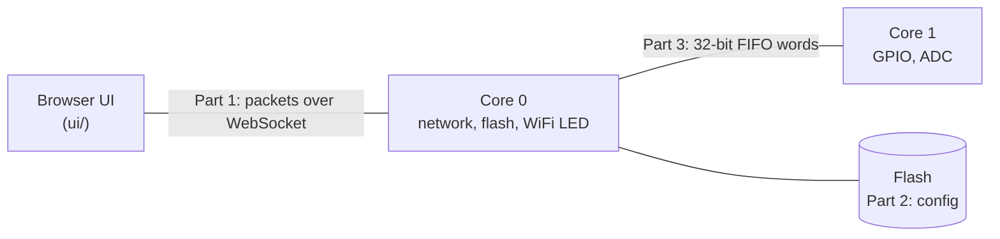
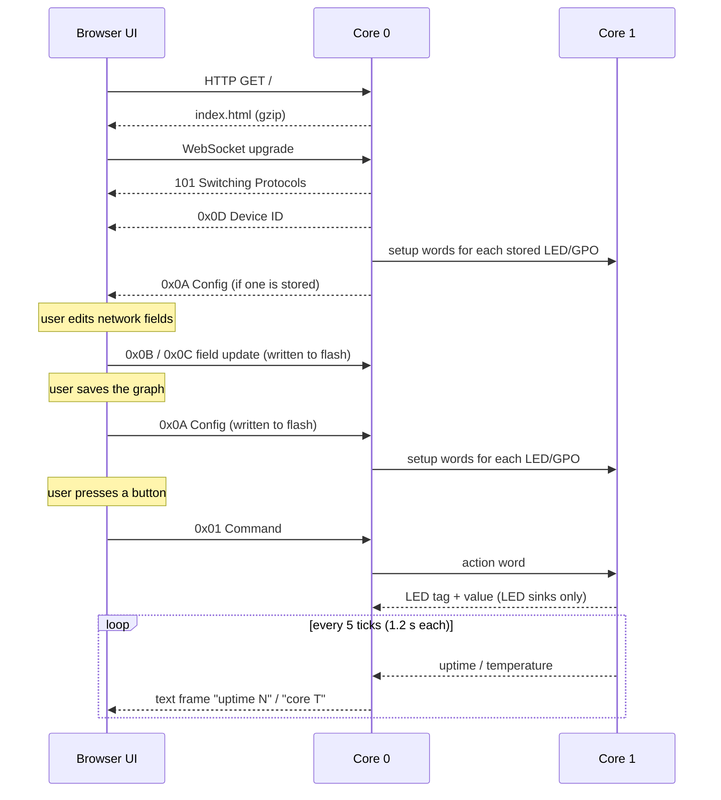

# neoGraph Protocol Reference

This document describes how the parts of neoGraph talk to each other, **as the code
behaves today**. Where the behaviour is surprising or wrong, it is described as-is
and listed under [Known issues](#known-issues).



| Part | What it covers | Code |
|---|---|---|
| [1. Transport](#part-1-transport-ui--hw) | Packets between the browser UI and the device | `src/websockets.c`, `src/tcpserver.c`, `ui/content/network.js` |
| [2. Config model](#part-2-config-model) | Messages, element types, the graph, networking, flash storage | `src/config.c`, `ui/content/graph.js`, `ui/content/components/` |
| [3. Inter-core FIFO](#part-3-inter-core-fifo-core-0--core-1) | Words between the two RP2350 cores | `src/hwman.c`, `src/main.c`, `src/config.c` |

## Conventions

- **Byte order.** Every multi-byte number is big endian.
- **Hex.** Bytes are written as two hex digits (`0A`), FIFO words as eight (`80000200`).
- **Status.** Tables mark each entry **Implemented**, **Partial** (some of it works) or
  **Reserved** (the number is allocated but no code sends or handles it).
- **Constants.** Every number named here has a constant in
  [`src/protocol.h`](src/protocol.h), mirrored in
  [`ui/content/protocol.js`](ui/content/protocol.js). Use the constants, not the numbers.
- **Examples are tested.** Every `hex example=…` and `fifo example=…` block in this file
  is extracted by `make test` and checked (see
  [Keeping this document honest](#keeping-this-document-honest)). In those blocks,
  `#` starts a comment.

---

## Part 1: Transport (UI ↔ HW)

### Connection

The device runs one TCP server on **port 80**.

- A plain HTTP request on any path returns the UI: one gzip-compressed HTML page.
- A request carrying `Upgrade: websocket` and `Connection: Upgrade` is upgraded to a
  WebSocket, on any path. The UI connects to `ws://<device host>`.

On the WebSocket:

- **Binary frames** carry one packet each (below).
- **Text frames** carry telemetry from the device (see [Telemetry](#telemetry-text-frames)).
- Ping is answered with pong, and close closes the connection.

### Session



### Packet header

| Byte | Field | Notes |
|---|---|---|
| 0 | Packet type | See the table below |
| 1–2 | Payload length | Bytes after the header, big endian |
| 3… | Payload | A sequence of [messages](#message-header), except for 0x0D |

### Packet types

| Type | Constant | Direction | Payload | Status |
|---|---|---|---|---|
| `01` | `PKT_COMMAND` | UI → HW | Messages | Implemented |
| `02` | `PKT_DATA_VALUE` | — | — | Reserved |
| `0A` | `PKT_CONFIG` | UI ↔ HW | Messages | Implemented |
| `0B` | `PKT_UPDATE_CONFIG` | UI → HW | One message | Implemented |
| `0C` | `PKT_UPDATE_SECRET` | UI → HW | One message | Implemented |
| `0D` | `PKT_DEVICE_ID` | HW → UI | 8 raw bytes | Implemented |

The device sends no reply or acknowledgement to any packet.

#### `0D` Device ID

Sent by the device immediately after the WebSocket handshake. The payload is the
8-byte unique board ID (the DID). The UI uses it to find its own device among the
`B0` device elements of the config that follows.

```hex example=device-id
0D 00 08                    # Device ID, 8 bytes
BD FC EA C1 4E 1E 79 4D     # DID
```

#### `0A` Config

The full configuration: networking, control and label elements. The same packet,
header included, is what the device stores in flash (see [Storage](#storage)).

- **HW → UI.** Sent on connect, after `0D`, if flash holds a config.
- **UI → HW.** Sent when the user saves the graph. The device writes the whole
  packet to flash, then sends setup words for each LED and GPO element to core 1.

[Part 2](#part-2-config-model) describes the payload; [The graph](#the-graph) has a
full example.

#### `01` Command

Sent by the UI when the user operates a UI input. Each message names the element
that was operated, with its new value as the payload.

| Message byte | Field | Notes |
|---|---|---|
| 0 | Message type | The type of the operated element, e.g. `10` button |
| 1 | Reserved | `00` |
| 2–3 | Element ID | The operated element |
| 4 | Payload length | `01` for a button |
| 5… | Value | Button: `00` released / `01` pressed (toggles on each click) |

For each message, core 0 sends one [action word](#core-0--core-1) to core 1 carrying
the first payload byte. The remaining payload bytes, if any, follow as extra words
(see [Known issues](#known-issues)).

```hex example=command-button
01 00 06                    # Command, 6 bytes
10 00 00 01 01  01          # button n1 → value 1
```

The UI currently sends `07` in the length field of this packet (see
[Known issues](#known-issues)); the device handles it the same way.

#### `0B` Update config field, `0C` Update secret field

Change one field of a networking element without resending the whole config. The
payload is one `B0`–`B3` message (see [Networking](#networking)).

The device looks through the stored messages for one with the **same type, element
ID and field ID** (first payload byte), and replaces that message with the new one.
`0B` edits the config store; `0C` edits the secrets store.

- If no stored message matches, nothing changes, and nothing is reported. These
  packets can change a field but cannot add one.
- The change is only written to flash. Networking reads it at the next boot.

```hex example=update-ssid
0B 00 08                    # Update config field, 8 bytes
B3 00 00 00 03  02 58 59    # network 0, field SSID = "XY"
```

```hex example=update-options
0B 00 07                    # Update config field, 7 bytes
B2 00 00 00 02  00 00       # network 0, field options = 0 (access point)
```

```hex example=update-password
0C 00 0E                    # Update secret field, 14 bytes
B3 00 00 00 09  03 6E 65 77 70 61 73 73 31   # network 0, field password = "newpass1"
```

### Telemetry text frames

Core 0 forwards core 1's [telemetry words](#core-1--core-0) to the most recently
connected client as WebSocket text frames:

| Text | Meaning |
|---|---|
| `uptime N` | Uptime in 1.2 s ticks (integer) |
| `core T` | Chip temperature in °C, two decimals |

The UI receives these but currently ignores them.

### Limits

| Limit | Value | Where |
|---|---|---|
| Received frame | 1024 bytes including the WebSocket header; one frame per TCP segment | `handle_websocket_msg` |
| Sent frame | 1024 bytes including the WebSocket header | `send_websocket_binary` |
| Stored config | 4096 bytes | `FLASH_SIZE` |
| Stored secrets | 256 bytes | `SECURE_FLASH_SIZE` |
| Clients | The most recent connection only receives telemetry | `tcp_server_accept` |

---

## Part 2: Config model

### Message header

Every packet payload except `0D` is a sequence of messages:

| Byte | Field | Notes |
|---|---|---|
| 0 | Message type | Which kind of element; see [Element types](#element-types) |
| 1 | Reserved | Always `00` |
| 2–3 | Element ID | Big endian |
| 4 | Payload length | Bytes after this header, 0–255 |
| 5… | Payload | Depends on the type |

### Element IDs

- **Control elements** (`00`–`3F`) get their IDs from the UI, counting from 1 on
  each page load. In the graph a node shows its ID as `n<ID>`.
- **Networking elements** (`B0`–`B3`) have their own IDs. The device and network
  created on first boot both have ID 0.
- **Strings** (`A0`) take the ID of the control element they label (see
  [Labels](#labels)).
- IDs are unique within each of those groups, not across them.
- **ID 0 in a source reference means "not connected"**, so a control element never
  has ID 0.

### Element types

Control types use bits 4 and 5 of the type byte:

```text
  7   6   5   4   3   2   1   0
+---+---+---+---+---------------+
| 0 | 0 | H | I |   subtype     |
+---+---+---+---+---------------+
H (MSG_HW_BIT, 0x20):    0 = UI element, 1 = hardware element
I (MSG_INPUT_BIT, 0x10): 0 = output,     1 = input
```

| Type | Constant | Element | Status |
|---|---|---|---|
| `00` | `MSG_UI_GAUGE` | UI output gauge | Reserved |
| `01` | `MSG_UI_INDICATOR` | UI output indicator | Reserved |
| `02` | `MSG_UI_GRAPH` | UI output graph | Reserved |
| `10` | `MSG_UI_BUTTON` | UI input button | Implemented |
| `11` | `MSG_UI_SWITCH` | UI input switch | Reserved |
| `12` | `MSG_UI_SLIDER` | UI input slider | Reserved |
| `13` | `MSG_UI_SLIDER_2D` | UI input 2D slider | Reserved |
| `14` | `MSG_UI_MULTI_SLIDER` | UI input multi slider | Reserved |
| `15` | `MSG_UI_DIAL` | UI input dial | Reserved |
| `16` | `MSG_UI_TIMER` | UI input timer | Reserved |
| `20` | `MSG_HW_LED` | HW output: onboard LED | Implemented |
| `21` | `MSG_HW_GPO` | HW output: GPIO pin | Implemented |
| `22` | `MSG_HW_PWM` | HW output: PWM | Reserved (commented out in `hwman.c`) |
| `30` | `MSG_HW_CORE` | HW input: core telemetry | Reserved |
| `31` | `MSG_HW_GPI` | HW input: GPIO pin | Reserved |
| `32` | `MSG_HW_ADC` | HW input: ADC | Reserved |
| `A0` | `MSG_STRING` | String: a node's label | Implemented |
| `B0` | `MSG_DEVICE` | Device | Implemented |
| `B1` | `MSG_DEVICE_FIELD` | Device field | Implemented |
| `B2` | `MSG_NETWORK` | Network | Implemented |
| `B3` | `MSG_NETWORK_FIELD` | Network field | Implemented |

### Control payloads

| Element | Payload length | Payload |
|---|---|---|
| `10` Button | 0 | None. The device ignores button messages in a config. |
| `20` LED | 2 | Bytes 0–1: source element ID (0 = not connected) |
| `21` GPO | 3 | Bytes 0–1: source element ID (0 = not connected) · byte 2: GPIO pin, 0–28 (UI default 1) |

Node positions are not part of the config. Labels are, as separate `A0` messages
(see [Labels](#labels)).

### The graph

The graph editor's nodes are control elements, and its wires are **source
references**. A wire is not a message of its own:

- An output (LED, GPO) has one input, so it stores the ID of the element wired to it.
- An input (button) can feed many outputs; it stores nothing about them.

When the user saves, the UI sends a `0A` config whose payload is:

1. the networking messages (`B0`–`B3`) of the last config the device sent, byte
   for byte, then
2. for each graph node, in the order the nodes were created, its control message
   followed by its label.

Control and label messages in the device's previous config are dropped, so a save
replaces the stored graph rather than adding to it.

When a config arrives, the UI puts each label onto the graph node with the same ID.
It ignores the other control messages, so nodes, wires and pins are not restored
(see [Known issues](#known-issues)).

Example: the demo graph with button `n1` wired to LED `n2` and to GPO `n3` on pin 1,
with `n1` and `n2` renamed, saved against the first-boot config below.

```hex example=save-config
0A 00 71                                        # Config, 113 bytes
# networking, kept from the device's config
B0 00 00 00 09  00 BD FC EA C1 4E 1E 79 4D      # device 0: DID
B1 00 00 00 05  01 4C 38 53 47                  # device 0: name "L8SG"
B1 00 00 00 03  02 00 00                        # device 0: network 0
B2 00 00 00 02  00 01                           # network 0: options = join
B3 00 00 00 05  01 4C 38 53 47                  # network 0: name "L8SG"
B3 00 00 00 04  02 4C 52 58                     # network 0: SSID "LRX"
# the graph
10 00 00 01 00                                  # button n1
A0 00 00 01 05  53 74 61 72 74                  #   label "Start"
20 00 00 02 02  00 01                           # LED n2 ← n1
A0 00 00 02 0C  50 6F 6D 70 65 20 C3 A0 20 65 61 75   #   label "Pompe à eau"
21 00 00 03 03  00 01 01                        # GPO n3 ← n1, pin 1
A0 00 00 03 03  47 50 4F                        #   label "GPO"
```

### Labels

A node's label is an `A0` String message:

| Byte | Field | Notes |
|---|---|---|
| 0 | Message type | `A0` |
| 1 | Reserved | `00` |
| 2–3 | Element ID | The ID of the node it labels |
| 4 | Payload length | 1–255 |
| 5… | Text | UTF-8, not null-terminated |

- The UI saves one label for every node, including unchanged default labels.
- The Settings view rejects a label longer than 255 bytes.
- The device stores labels with the rest of the config and sends them back on
  connect. It sends nothing to core 1 for them.
- Labels add to the config's size. See known issue 1 for the current limit of
  about 1 KB.

### Networking

Four element types describe devices and networks. The payload of each starts with a
**field ID**, followed by the field's value:

| Byte | Field |
|---|---|
| 0 | Field ID |
| 1… | Field value (payload length − 1 bytes) |

- `B0` declares a **device** and `B2` declares a **network**. Their element ID is the
  device's or network's ID, and they carry one field.
- `B1` and `B3` set further fields on the device or network with the same element ID.
  Each message sets one field.

| Element | Field | Constant | Value | Store |
|---|---|---|---|---|
| `B0`/`B1` device | `00` DID | `FIELD_DEVICE_DID` | 8 bytes | config |
| | `01` name | `FIELD_DEVICE_NAME` | ASCII, up to 31 bytes | config |
| | `02` network | `FIELD_DEVICE_NETWORK` | 2-byte network ID | config |
| `B2`/`B3` network | `00` options | `FIELD_NETWORK_OPTIONS` | 1 byte, see below | config |
| | `01` name | `FIELD_NETWORK_NAME` | ASCII, up to 31 bytes | config |
| | `02` SSID | `FIELD_NETWORK_SSID` | ASCII, up to 31 bytes | config |
| | `03` password | `FIELD_NETWORK_PASSWORD` | ASCII, up to 31 bytes | **secrets** |

Network options, bit 0 (`NET_OPT_JOIN`): `0` = start an access point (with a DHCP
server) using the SSID and password; `1` = join an existing network. Other bits are
unused.

At boot, the device finds the `B0` whose DID matches its own, reads that device's
fields, then reads the fields of the network it points to. It reads the config store
first and then the secrets store. The UI does the same with the DID from `0D`, and
does not read the password.

### Storage

The config and the secrets are each stored as a complete `0A` packet, header
included, at the end of flash:

| Region | Offset from end of flash | Size | Holds |
|---|---|---|---|
| Config | −4096 | 4096 bytes | Everything except passwords; sent to the UI on connect |
| Secrets | −4352 | 256 bytes | `B3` password fields; never sent to the UI |

On boot, if the config region does not start with `0A`, the device writes a default
config and default secrets:

- **Device 0**, with the board's DID. Its name is 4 characters derived from the DID:
  a letter, then three letters or digits.
- **Network 0**, with the same name, options = join, and SSID `LRX`.
- **Secrets**: a `B3` password field for network 0 with a fixed 8-character password
  (`build_secrets` in `src/config.c`).

```hex example=default-config
0A 00 3A                                        # Config, 58 bytes
B0 00 00 00 09  00 BD FC EA C1 4E 1E 79 4D      # device 0: DID
B1 00 00 00 05  01 4C 38 53 47                  # device 0: name "L8SG"
B1 00 00 00 03  02 00 00                        # device 0: network 0
B2 00 00 00 02  00 01                           # network 0: options = join
B3 00 00 00 05  01 4C 38 53 47                  # network 0: name "L8SG"
B3 00 00 00 04  02 4C 52 58                     # network 0: SSID "LRX"
```

---

## Part 3: Inter-core FIFO (core 0 ↔ core 1)

The RP2350's two cores share a pair of hardware FIFOs, one in each direction, that
carry 32-bit words.

- **Core 0** runs networking and flash, and drives the onboard LED. The LED is
  attached to the WiFi chip, which only core 0 talks to.
- **Core 1** owns the GPIO pins and the ADC.

### Core 0 → core 1

Every exchange starts with an **operation word**:

```text
 31 30 29 28       24 23                      8 7             0
+-----+--+-----------+-------------------------+---------------+
| op  |--| type&0x1F |       element ID        |  value / pin  |
+-----+--+-----------+-------------------------+---------------+
```

| `op` | Constant | Sent by | Followed by |
|---|---|---|---|
| 1 | `FIFO_OP_CONTROL_ACTION` | `01` command, one per message | One word per further 4 payload bytes (none for a button) |
| 2 | `FIFO_OP_SETUP` | `0A` config and on each connect, one per LED/GPO message | One reference word |
| 3 | `FIFO_OP_CLEAN_SETUP` | Nothing | — |

Only the low 5 bits of the element type travel. Core 1 sets bit 5 on decode, so it
always sees a hardware type: LED `20` and GPO `21` survive, but a button `10`
arrives as `30`.

The **reference word** after a setup word carries the source element ID:

```text
 31                      16 15                             0
+-------------------------+--------------------------------+
|    source element ID    |               0                |
+-------------------------+--------------------------------+
```

`fifo_op_word`, `fifo_ref_word` and the matching decoders in `src/protocol.h` build
and read these words.

The setup words for the [save-config example](#the-graph). The button is skipped,
and each LED/GPO message becomes an operation word plus a reference word:

```fifo example=save-config
80000200 00010000           # setup LED n2, source n1
81000301 00010000           # setup GPO n3 on pin 1, source n1
```

The action word for the [command-button example](#01-command):

```fifo example=command-button
50000101                    # action, type 10 → 30, element n1, value 1
```

### Core 1 behaviour

Core 1 keeps a table from **source ID → the outputs wired to it**.

- **Setup** (`op` 2): reads the reference word (waiting up to 1 ms) and adds the
  output to the table under its source. For a GPO it also makes the pin an output.
- **Action** (`op` 1): looks up the element ID as a source and drives each output
  wired to it with the value byte. A GPO is set directly; an LED is passed back to
  core 0 with an LED tag (below).
- **Clean setup** (`op` 3): clears the table and resets all GPIO pins and PWM slices,
  then carries on as if it were an action word.

### Core 1 → core 0

Each message is two words: a **tag**, then a **value**.

| Tag | Constant | Value | Core 0 does |
|---|---|---|---|
| 0 | `FIFO_TAG_UPTIME` | Uptime in 1.2 s ticks | Sends text frame `uptime N` |
| 1 | `FIFO_TAG_TEMPERATURE` | `float` bits, °C | Sends text frame `core T` |
| 2 | `FIFO_TAG_LED` | 0 or 1 | Sets the onboard LED |

Uptime is first sent at tick 5 and temperature at tick 6, then each every 5 ticks.

---

## Known issues

Current behaviour that is probably not intended. Each one is a candidate for its own fix.

**Transport**

1. **A config above about 1 KB overflows the send buffer.** `send_websocket_binary`
   copies up to 4096 bytes into a 1024-byte frame buffer.
2. **Received frames are not checked.** A frame must arrive in one TCP segment and fit
   in 1024 bytes. The packet's length field is not checked against the frame length.
3. **Only the latest connection is tracked.** Every new TCP connection takes
   `clients[0]`, so only the most recent client receives telemetry.
4. **`0B`/`0C` fail silently** when no stored message matches, and the UI has no way
   to tell.
5. **The UI's command packet has the wrong length.** `button.js` sets the payload
   length to 7 for a 6-byte payload. The device's message iterator stops at the last
   complete message, so the extra byte is ignored.

**Config and graph**

6. **Only labels are restored on connect.** The UI ignores the control messages in a
   received config and always starts from its built-in demo graph (`n1`–`n3`), so
   saved nodes, wires and pins are not redrawn. A saved label comes back only if a
   node with its ID exists.
7. **The button config payload is empty.** The earlier reference described a 7-byte
   payload (label ID, X, Y, style) that was never implemented.
8. **Network IDs above 255 are misread in the UI.** `unmarshalConfigs` uses `||`
   instead of `|` to combine the ID bytes.
9. **Field values are copied without a length check.** The device copies names, SSIDs
   and passwords into 32-byte buffers using the message's length.
10. **The first-boot defaults are hardcoded:** SSID `LRX`, a fixed password, and
    options = join, so a fresh board tries to join that network rather than start
    its own access point.

**Flash**

11. **Flash is written while core 1 is running.** `write_config` and
    `update_config` disable interrupts on core 0 only. If core 1 executes from flash
    during the erase, it can crash. The Pico SDK's `flash_safe_execute` handles this.

**Inter-core FIFO**

12. **Controls are set up again on every connect.** `retrieve_store` sends setup
    words each time a client connects, and `0A` sends them again. Nothing sends clean
    setup (`op` 3), so core 1's table gains duplicates each time.
13. **Clean setup falls through into the action handler** (missing `break`).
14. **Extra action words are never read.** Core 0 sends one word per further 4
    payload bytes, but core 1 doesn't read them, so it would treat them as operation
    words. It also reads past the payload when the length isn't 1 + 4n. Buttons are
    unaffected (length 1).
15. **A setup word whose reference word is late uses stale data.** If the reference
    word misses its 1 ms timeout, core 1 decodes the setup word itself as the
    reference.
16. **There is no framing.** Tags and values, and operation and extra words, are told
    apart only by order, so one lost or extra word desyncs everything after it.
17. **Uptime counts 1.2 s ticks**, not seconds.

---

## Keeping this document honest

- **Constants** live in [`src/protocol.h`](src/protocol.h) and
  [`ui/content/protocol.js`](ui/content/protocol.js). `make test` fails if a `PKT_`,
  `MSG_`, `FIELD_` or `NET_OPT_` constant is missing from either file or has a
  different value.
- **Examples.** `make test` extracts every `hex example=<name>` and
  `fifo example=<name>` block from this file into `tests/protocol_examples.h`
  (`make/examples.awk`). `tests/test_protocol.c` then checks:
  - every packet example is well formed (known packet type, the length field matches,
    the messages fill the payload exactly, reserved bytes are 0);
  - the specific contents of the examples above;
  - each `fifo` example matches the words `src/protocol.h` builds from the packet
    example of the same name.

  A new packet example gets the structural checks automatically.
