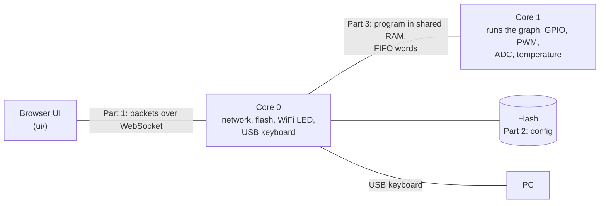
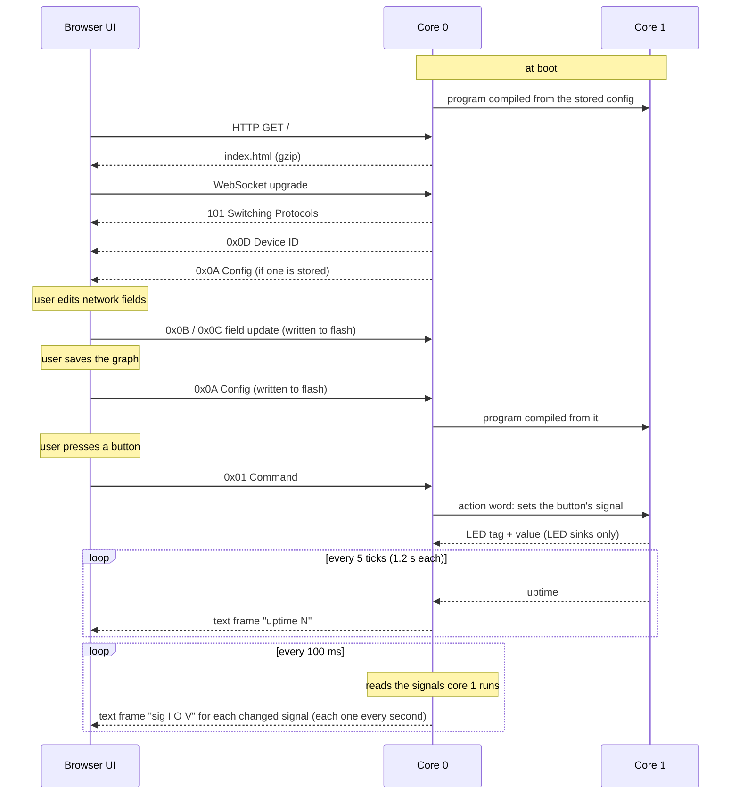
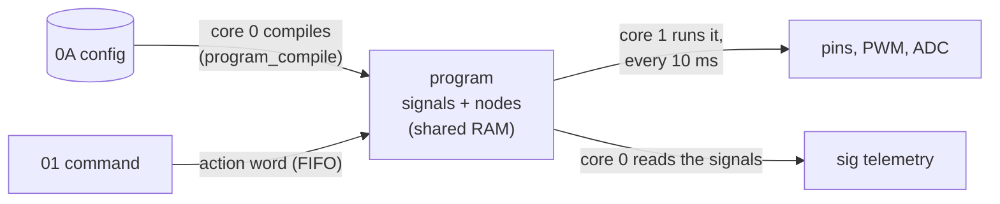
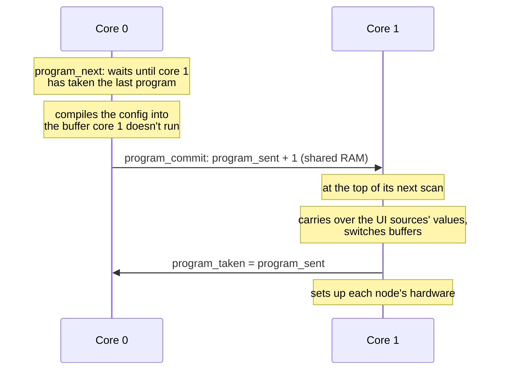
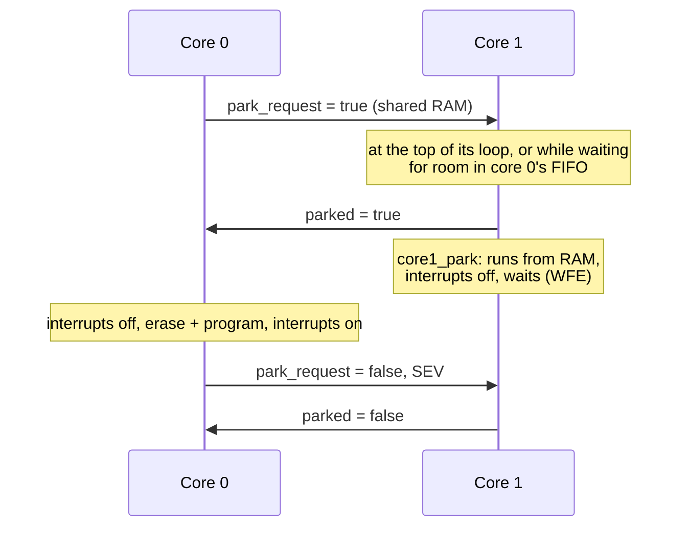

# neoGraph Protocol Reference

This document describes how the parts of neoGraph talk to each other, **as the code
behaves today**. Where the behaviour is surprising or wrong, it is described as-is
and listed under [Known issues](#known-issues).



| Part | What it covers | Code |
|---|---|---|
| [1. Transport](#part-1-transport-ui--hw) | Packets between the browser UI and the device | `src/websockets.c`, `src/tcpserver.c`, `ui/content/network.js` |
| [2. Config model](#part-2-config-model) | Messages, element types, the graph, networking, flash storage | `src/config.c`, `ui/content/graph.js`, `ui/content/components/` |
| [3. Core 0 ↔ core 1](#part-3-core-0--core-1) | The program core 1 runs, and the words between the two RP2350 cores | `src/program.c`, `src/hwman.c`, `src/main.c`, `src/config.c` |
| [USB keyboards](#usb-keyboards) | Keystrokes typed to the PC the device is plugged into | `src/keyboard.c`, `src/usb_descriptors.c`, `ui/content/components/keyboard.js` |

## Conventions

- **Byte order.** Every multi-byte number is big endian.
- **Hex.** Bytes are written as two hex digits (`0A`), FIFO words as eight (`80000200`).
- **Status.** Tables mark each entry **Implemented**, **Partial** (some of it works) or
  **Reserved** (the number is allocated but no code sends or handles it).
- **Constants.** Every number named here has a constant in
  [`src/protocol.h`](src/protocol.h), mirrored in
  [`ui/content/protocol.js`](ui/content/protocol.js). Use the constants, not the numbers.
- **Examples are tested.** Every `hex example=…`, `fifo example=…` and `program example=…` block in this file
  is extracted by `make test` and checked (see
  [Keeping this document honest](#keeping-this-document-honest)). In those blocks,
  `#` starts a comment.

---

## Part 1: Transport (UI ↔ HW)

### Connection

The device runs one TCP server on **port 80**.

- A plain HTTP request on any path returns the UI: one gzip-compressed HTML page.
- A request carrying `Upgrade: websocket` and `Connection: Upgrade` is upgraded to a
  WebSocket, on any path. The UI connects to `ws://<device host>`.

On the WebSocket:

- **Binary frames** carry one packet each (below).
- **Text frames** carry telemetry from the device (see [Telemetry](#telemetry-text-frames)).
- Ping is answered with pong, and close closes the connection.

### Session



### Packet header

| Byte | Field | Notes |
|---|---|---|
| 0 | Packet type | See the table below |
| 1–2 | Payload length | Bytes after the header, big endian |
| 3… | Payload | A sequence of [messages](#message-header), except for 0x0D |

### Packet types

| Type | Constant | Direction | Payload | Status |
|---|---|---|---|---|
| `01` | `PKT_COMMAND` | UI → HW | Messages | Implemented |
| `02` | `PKT_DATA_VALUE` | — | — | Reserved |
| `0A` | `PKT_CONFIG` | UI ↔ HW | Messages | Implemented |
| `0B` | `PKT_UPDATE_CONFIG` | UI → HW | One message | Implemented |
| `0C` | `PKT_UPDATE_SECRET` | UI → HW | One message | Implemented |
| `0D` | `PKT_DEVICE_ID` | HW → UI | 8 raw bytes | Implemented |

The device sends no reply or acknowledgement to any packet.

#### `0D` Device ID

Sent by the device immediately after the WebSocket handshake. The payload is the
8-byte unique board ID (the DID). The UI uses it to find its own device among the
`B0` device elements of the config that follows.

```hex example=device-id
0D 00 08                    # Device ID, 8 bytes
BD FC EA C1 4E 1E 79 4D     # DID
```

#### `0A` Config

The full configuration: networking elements and the graph. The same packet,
header included, is what the device stores in flash (see [Storage](#storage)).

- **At boot.** If flash holds a config, core 0 compiles it into a program for core 1
  (see [Part 3](#part-3-core-0--core-1)), so the graph runs without a browser.
- **HW → UI.** Sent on connect, after `0D`, if flash holds a config. The UI
  rebuilds its graph from it (see [Restoring the graph](#restoring-the-graph)).
  Connecting doesn't set core 1 up again: its outputs keep their state.
- **UI → HW.** Sent when the user saves the graph. The device writes the whole
  packet to flash, then compiles it into a program, which core 1 runs from its next
  scan.

[Part 2](#part-2-config-model) describes the payload; [The graph](#the-graph) has a
full example.

#### `01` Command

Sent by the UI when the user operates a UI input. Each message names the element
that was operated, with the values of its outputs as the payload.

| Message byte | Field | Notes |
|---|---|---|
| 0 | Message type | The type of the operated element: `10` button, `12` slider or `13` 2D slider |
| 1 | Flags | `00` |
| 2–3 | Element ID | The operated element |
| 4 | Payload length | The element's number of outputs: `01`, or `02` for a 2D slider |
| 5… | Values | One byte per output, in output order, each a fraction of full scale: `00` = 0 to `FF` = 1 (`VALUE_FULL`) |

**Values** run from 0 to 1, sent as one byte, `round(value × 255)`:

- **Button:** `00` released / `FF` pressed. A toggle button changes on each click; a
  momentary one (`BUTTON_MOMENTARY`) sends `FF` when pressed and `00` when let go.
- **Slider:** its position, `00`–`FF` (shown as 0.00–1.00). Dragging sends a command
  each time the byte changes.
- **2D slider:** X, then Y (see [2D sliders](#2d-sliders)). Dragging sends a command,
  with both values, each time either byte changes.

On the device each value becomes the [signal](#signals) of that output of the element,
0 to 1 (byte ÷ 255). Outputs read it: an LED or GPO is on from 0.5 up (`80`,
`VALUE_HALF`, and up). A PWM maps it onto its duty cycle or frequency, whichever that
input drives (see [Control payloads](#control-payloads)).

For each message, core 0 sends one [action word](#core-0--core-1-action-words) to core 1
per payload byte: byte *i* is the new value of the element's output *i*. Bytes after
the first `FIFO_OUTPUTS_MAX` (32) are ignored.

```hex example=command-button
01 00 06                    # Command, 6 bytes
10 00 00 01 01  FF          # button n1 → pressed, value 1
```

```hex example=command-slider
01 00 06                    # Command, 6 bytes
12 00 00 04 01  BF          # slider n4 → value 0.75
```

```hex example=command-slider-2d
01 00 07                    # Command, 7 bytes
13 00 00 06 02  FF 80       # 2D slider n6 → X 1, Y 0.5
```

#### `0B` Update config field, `0C` Update secret field

Change one field of a networking element without resending the whole config. The
payload is one `B0`–`B3` message (see [Networking](#networking)).

The device looks through the stored messages for one with the **same type, element
ID and field ID** (first payload byte), and replaces that message with the new one.
`0B` edits the config store; `0C` edits the secrets store.

- **`0B` adds a field** the device or network doesn't have yet (a `B1` or `B3`): the
  message goes after the element's last message, so fields added later, such as
  the [addresses](#network-addresses), can be set on a device configured before them.
  `0C` only replaces.
- **A password is never stored by `0B`:** the config store is sent to the UI.
- If the element isn't stored (`0B`) or no stored message matches (`0C`), or the
  result would not fit its flash region, nothing changes, and nothing is reported.
- The UI applies each `0B` to its copy of the config too, so saving the graph, which
  sends the networking messages back, keeps the change.
- The change is only written to flash. Networking reads it at the next boot.

```hex example=update-ssid
0B 00 08                    # Update config field, 8 bytes
B3 00 00 00 03  02 58 59    # network 0, field SSID = "XY"
```

```hex example=update-options
0B 00 07                    # Update config field, 7 bytes
B2 00 00 00 02  00 00       # network 0, field options = 0 (access point)
```

```hex example=update-ap-address
0B 00 0A                    # Update config field, 10 bytes
B3 00 00 00 05  04 0A 00 00 01   # network 0, field access point address = 10.0.0.1
```

```hex example=update-password
0C 00 0E                    # Update secret field, 14 bytes
B3 00 00 00 09  03 6E 65 77 70 61 73 73 31   # network 0, field password = "newpass1"
```

### Telemetry text frames

Core 0 sends the most recently connected client WebSocket text frames:

| Text | Meaning |
|---|---|
| `uptime N` | Uptime in 1.2 s ticks (integer), from core 1's [uptime word](#core-1--core-0) |
| `sig I O V` | The value V of output O of element `nI`: a [signal](#signals) of the program core 1 runs, in its unit (°C, volts, 0 to 1), up to 4 significant digits |

- **Signals.** Every 100 ms core 0 reads the signals of the program core 1 runs, and
  sends a `sig` frame for each one whose value has changed; every second, and when
  core 1 takes a new program, it sends every one. A browser that connects learns them
  all within a second.
- **In the UI.** A `sig` frame goes to the node `nI`. A hardware input or logic
  element hands the value to the nodes wired to it: a [core temperature](#core-temperature)
  in °C, an [ADC](#adc-inputs) in volts, a [GPIO input](#gpio-inputs) or
  [logic](#logic) on from 0.5. Other nodes, such as a button or slider, ignore theirs,
  and so does an element the page doesn't have. The UI ignores `uptime N`.

```text
sig 1 0 31.27               # core temperature n1: 31.27 °C
sig 10 0 1.65               # ADC n10: 1.65 V
sig 19 0 1                  # GPIO input n19: on
sig 6 1 0.502               # 2D slider n6, Y: 0.502
sig 4 1 2                   # counter n4, its count: 2
```

### Limits

| Limit | Value | Where |
|---|---|---|
| Config packet | 4096 bytes including the packet header (`PKT_CONFIG_MAX`). The UI refuses to save a bigger graph, and the device refuses to store one. | `PKT_CONFIG_MAX`, `FLASH_SIZE` |
| Received frame | 4110 bytes including the WebSocket header (`WS_RX_BUF`: one frame carrying the largest packet). A frame may span TCP segments, and a segment may hold several frames; a bigger frame closes the connection. Fragmented messages (continuation frames) are not supported. | `handle_websocket_msg` |
| Sent frame | 65535 bytes, and no more than lwIP's free send buffer (`TCP_SND_BUF`, 17520 bytes) | `send_websocket_frame` |
| UI page | No limit: it is streamed from flash one segment at a time as the browser acknowledges it | `send_page` |
| Stored secrets | 256 bytes | `SECURE_FLASH_SIZE` |
| Clients | The most recent connection only receives telemetry | `tcp_server_accept` |

---

## Part 2: Config model

### Message header

Every packet payload except `0D` is a sequence of messages:

| Byte | Field | Notes |
|---|---|---|
| 0 | Message type | Which kind of element; see [Element types](#element-types) |
| 1 | Flags | Bit 0 `MSG_FLAG_OUTPUT`: the payload's [source references](#source-references) name an output. Bit 1 `MSG_FLAG_SHOWN`: a hardware input (`30` core temperature, `31` GPIO input, `32` ADC) or a logic element (`40`–`4B`) shows a tile in the Command view; the device ignores it (see [Hardware input tiles](#hardware-input-tiles)). Other bits are 0. |
| 2–3 | Element ID | Big endian |
| 4 | Payload length | Bytes after this header, 0–255 |
| 5… | Payload | Depends on the type |

### Element IDs

- **Control elements** (`00`–`7F`) get their IDs from the UI, counting from 1 on
  each page load. In the graph a node shows its ID as `n<ID>`.
- **Networking elements** (`B0`–`B3`) have their own IDs. The device and network
  created on first boot both have ID 0.
- **Labels, positions and wires** (`A0`–`A2`) take the ID of the control element
  they describe (see [Labels, positions and wires](#labels-positions-and-wires)).
- IDs are unique within each of those groups, not across them.
- **ID 0 in a source reference means "not connected"**, so a control element never
  has ID 0.

### Source references

An output names the input wired to it with a **source reference**: which element,
and which of its outputs. Most sources have one output, 0; a
[2D slider](#2d-sliders) has two, X (0) and Y (1), and a [counter](#logic) two, done
(0) and its count (1).

| Message flags | Reference | Bytes |
|---|---|---|
| `MSG_FLAG_OUTPUT` (`01`) | The element ID, then its output | 3 |
| `00` | The element ID; its output is 0 | 2 |

- **The UI writes every reference with its output:** LED, GPO, PWM, USB keyboard and
  plot messages, and a PWM's `A2` wires, have the flag set.
- **Configs saved before sources had several outputs** have 2-byte references and the
  flag clear. The device and the UI still read them, as output 0, and the next save
  writes them with outputs. A `legacy-config` example is below.
- **Not connected** is ID 0, output 0.
- **A feedback wire** (see [Loops](#loops)) has bit 7 of its output byte set
  (`MSG_REF_FEEDBACK`, `80`): `00 04 80` is output 0 of `n4`, fed back. Bits 0–6 are
  the output. Only a reference in a logic element's payload is a feedback one.
- The payload tables below give the bytes with the flag set.

```hex example=legacy-config
0A 00 0C                                        # Config, 12 bytes
10 00 00 01 00                                  # button n1
20 00 00 02 02  00 01                           # LED n2 ← n1 (output 0), saved without outputs
```

### Element types

Control types use bits 4 to 6 of the type byte:

```text
  7   6   5   4   3   2   1   0
+---+---+---+---+---------------+
| 0 | 0 | H | I |   subtype     |   UI and hardware elements
+---+---+---+---+---------------+
| 0 | 1 |       subtype         |   logic elements
+---+---+-----------------------+
L (MSG_LOGIC_BIT, 0x40): 1 = logic element: runs on the device, reads sources, and is a source
                         (`MSG_LOGIC_LAST`, 0x4C, is the last defined)
H (MSG_HW_BIT, 0x20):    0 = UI element, 1 = hardware element
I (MSG_INPUT_BIT, 0x10): 0 = output,     1 = input
```

| Type | Constant | Element | Status |
|---|---|---|---|
| `00` | `MSG_UI_GAUGE` | UI output gauge | Reserved |
| `01` | `MSG_UI_INDICATOR` | UI output indicator: a light | Implemented |
| `02` | `MSG_UI_GRAPH` | UI output graph: a plot | Implemented |
| `10` | `MSG_UI_BUTTON` | UI input button | Implemented |
| `11` | `MSG_UI_SWITCH` | UI input switch | Reserved |
| `12` | `MSG_UI_SLIDER` | UI input slider | Implemented |
| `13` | `MSG_UI_SLIDER_2D` | UI input 2D slider: two outputs, X and Y | Implemented |
| `14` | `MSG_UI_MULTI_SLIDER` | UI input multi slider | Reserved |
| `15` | `MSG_UI_DIAL` | UI input dial | Reserved |
| `16` | `MSG_UI_TIMER` | UI input timer | Reserved |
| `20` | `MSG_HW_LED` | HW output: onboard LED | Implemented |
| `21` | `MSG_HW_GPO` | HW output: GPIO pin | Implemented |
| `22` | `MSG_HW_PWM` | HW output: PWM pin | Implemented |
| `23` | `MSG_HW_KEYBOARD` | HW output: a keystroke typed to the PC over USB | Implemented |
| `30` | `MSG_HW_CORE` | HW input: core temperature | Implemented |
| `31` | `MSG_HW_GPI` | HW input: GPIO pin | Implemented |
| `32` | `MSG_HW_ADC` | HW input: ADC | Implemented |
| `40` | `MSG_LOGIC_COMPARE` | Logic: a floating input above or below a threshold | Implemented |
| `41` | `MSG_LOGIC_AND` | Logic: on while every input is on | Implemented |
| `42` | `MSG_LOGIC_OR` | Logic: on while any input is on | Implemented |
| `43` | `MSG_LOGIC_NOT` | Logic: on while its input is off | Implemented |
| `44` | `MSG_LOGIC_DELAY` | Logic: its input, after an on and an off delay | Implemented |
| `45` | `MSG_LOGIC_SCALE` | Logic: a floating input mapped from one range onto another | Implemented |
| `46` | `MSG_LOGIC_MIN` | Logic: the least of its floating inputs | Implemented |
| `47` | `MSG_LOGIC_MAX` | Logic: the greatest of its floating inputs | Implemented |
| `48` | `MSG_LOGIC_PULSE` | Logic: on for a time after its input goes on | Implemented |
| `49` | `MSG_LOGIC_BLINK` | Logic: on and off in turn while its input is on | Implemented |
| `4A` | `MSG_LOGIC_TOGGLE` | Logic: turns over each time its input goes on | Implemented |
| `4B` | `MSG_LOGIC_LATCH` | Logic: on once set, off once reset | Implemented |
| `4C` | `MSG_LOGIC_COUNTER` | Logic: counts its input going on, up to a preset; two outputs, done and its count | Implemented |
| `A0` | `MSG_STRING` | String: a node's label | Implemented |
| `A1` | `MSG_LAYOUT` | A node's position in the graph | Implemented |
| `A2` | `MSG_WIRE` | The shape of the wire into an output | Implemented |
| `B0` | `MSG_DEVICE` | Device | Implemented |
| `B1` | `MSG_DEVICE_FIELD` | Device field | Implemented |
| `B2` | `MSG_NETWORK` | Network | Implemented |
| `B3` | `MSG_NETWORK_FIELD` | Network field | Implemented |

### Control payloads

| Element | Payload length | Payload |
|---|---|---|
| `10` Button | 0–1 | Byte 0, bit 0 (`BUTTON_MOMENTARY`): 0 = each click toggles it, 1 = it is on while held. Other bits are 0. The UI leaves the byte out for a toggle button (as buttons saved before it existed), and sends `01` for a momentary one. The device ignores button messages in a config. |
| `12` Slider | 1 | Byte 0, bit 0 (`SLIDER_VERTICAL`): 0 = horizontal (UI default), 1 = vertical. Other bits are 0. The device ignores slider messages in a config: the orientation is for the Command view. |
| `13` 2D slider | 1–4 | Byte 0, bit 0 (`SLIDER_RETURN`): 0 = it stays where it is let go (UI default), 1 = it returns home. Bits 1–2 (`SLIDER_EASE_MASK`), how it returns: `SLIDER_EASE_IMMEDIATE` (`00`), `SLIDER_EASE_LINEAR` (`02`, UI default) or `SLIDER_EASE_SIGMOID` (`04`). Other bits are 0. Byte 1: the return speed, 1–255 % of its range per second (UI default 100); without it, the return is immediate. Bytes 2–3: its home, X then Y as values, `00`–`FF` (UI default `80 80`, the centre); without them, the centre. The device uses only the home: it drives the slider's outputs there (`slider_2d_home`). See [2D sliders](#2d-sliders). |
| `01` Light | 3 | Bytes 0–2: source reference (0 = not connected). The device ignores light messages in a config: the light is drawn in the browser (see [Lights](#lights)). |
| `02` Plot | 4–20 | Bytes 0–2: source reference (0 = not connected) · byte 3: time window, 1–255 s (UI default 10) · bytes 4…: the unit, 0–16 bytes of UTF-8 text; none (the UI default) shows the source's unit. The device ignores plot messages in a config: the plot is drawn in the browser (see [Plots](#plots)). |
| `30` Core temperature | 0 | None: the chip has one sensor. See [Core temperature](#core-temperature). |
| `31` GPIO input | 2 | Byte 0: the GPIO pin, a [usable](#gpio-pins) one (UI default 3). Byte 1: options; bits 0–1 (`GPI_PULL_MASK`) the pin's pull, `GPI_PULL_NONE` (0), `GPI_PULL_UP` (1) or `GPI_PULL_DOWN` (2, UI default); bit 2 (`GPI_INVERT`): 0 = on while the pin is high (UI default), 1 = on while it is low. Other bits are 0. See [GPIO inputs](#gpio-inputs). |
| `32` ADC | 1 | Byte 0: the ADC channel, 0 to `ADC_CHANNELS` − 1 (2), on GPIO `ADC_PIN_FIRST` (26) + channel (UI default 0). See [ADC inputs](#adc-inputs). |
| `20` LED | 3 | Bytes 0–2: source reference (0 = not connected) |
| `21` GPO | 4 | Bytes 0–2: source reference (0 = not connected) · byte 3: GPIO pin, a [usable](#gpio-pins) one (UI default 1) |
| `22` PWM | 17 | See below |
| `40` Compare | 12 | Bytes 0–2: source reference (0 = not connected) · byte 3: `COMPARE_ABOVE` (0) or `COMPARE_BELOW` (1) · bytes 4–7: threshold · bytes 8–11: hysteresis, 0 or more. Both are 32-bit IEEE 754 floats, big endian, finite, in the source's unit. See [Logic](#logic). |
| `41` AND, `42` OR | 3–12 | 1 to `LOGIC_INPUTS_MAX` (4) source references (0 = not connected). See [Logic](#logic). |
| `43` NOT | 3 | Bytes 0–2: source reference (0 = not connected) |
| `44` Delay | 11 | Bytes 0–2: source reference (0 = not connected) · bytes 3–6: on delay · bytes 7–10: off delay. Each a 32-bit big-endian number of milliseconds, 0 to `DELAY_MAX_MS` (86400000, a day). See [Logic](#logic). |
| `45` Scale | 20 | Bytes 0–2: source reference · byte 3: options, bit 0 `SCALE_CLAMP`: keep the output within its range · bytes 4–19: the input's from and to, then the output's from and to, each a 32-bit big-endian float, finite; the input's two differ. See [Logic](#logic). |
| `46` Min, `47` Max | 3–12 | 1 to `LOGIC_INPUTS_MAX` (4) source references (0 = not connected) |
| `48` Pulse | 7 | Bytes 0–2: source reference · bytes 3–6: its time on, milliseconds, 1 to `DELAY_MAX_MS` |
| `49` Blink | 11 | Bytes 0–2: source reference (0: it always blinks) · bytes 3–6: time on · bytes 7–10: time off, each milliseconds, 1 to `DELAY_MAX_MS` |
| `4A` Toggle | 3 | Bytes 0–2: source reference |
| `4B` Latch | 6 | Bytes 0–2: its set source reference · bytes 3–5: its reset source reference (each 0 = not connected) |
| `4C` Counter | 10 | Bytes 0–2: its count source reference · bytes 3–5: its reset source reference (each 0 = not connected) · bytes 6–9: its preset, a 32-bit big-endian number, 1 to `COUNTER_MAX` (1000000; UI default 3). See [Logic](#logic). |
| `23` USB keyboard | 6, or 5–68 | Bytes 0–2: source reference (0 = not connected) · byte 3: `KEYBOARD_COMBO` (0) or `KEYBOARD_TEXT` (1) · then a combo's HID modifier bits and HID key, or 1–64 characters of text. See [USB keyboards](#usb-keyboards). |

Without `MSG_FLAG_OUTPUT` each [source reference](#source-references) is a byte
shorter, and so is everything after it: an LED is 2 bytes, a GPO 3, a PWM 15, a plot
3–19 and a keyboard 5 or 4–67. `pwm_payload_read` and `keyboard_payload_valid` in
`src/protocol.h` read either.

#### GPIO pins

A GPO or PWM may use **GPIO 0–22 and 26–28**, the pins on the Pico 2 W's header
(`PIN_USABLE_MASK`, bit n for GPIO n). GPIO 23, 24, 25 and 29 drive the WiFi chip:
changing them cuts the device off the network.

- The UI offers only the usable pins, and keeps the default pin when a config names
  another one.
- **One node per pin.** A GPO, PWM or GPIO input is offered only the pins no other node
  uses, and an ADC only the channels whose pin (GPIO 26–28) no other node uses. A new
  node takes its default pin (GPO 1, PWM 2, GPIO input 3) if it is free, otherwise the
  lowest free one; a new ADC the first free channel.
- **One PWM per slice.** The pins of a PWM slice share its counter, so its frequency:
  GPIO *n* is on slice (*n* >> 1) & 7, so GPIO 0, 1, 16 and 17 are slice 0, GPIO 2, 3,
  18 and 19 slice 1, and so on. A PWM is not offered any pin on another PWM's slice,
  and a new one takes a free pin on a free slice. A GPO or GPIO input may still use
  them: it doesn't use the slice.
- Core 1 doesn't set up a GPO or PWM on another pin, and logs that it skipped it.

A PWM has two parameters, its **duty cycle** and its **frequency**. Each is constant, or
follows an input: a source element whose value maps linearly onto it, 0 → min and
1 → max (min may be above max, which inverts the input). The payload:

| Bytes | Field | Range (UI default) |
|---|---|---|
| 0–2 | Duty source reference, 0 = none | |
| 3 | GPIO pin | A [usable](#gpio-pins) one (2) |
| 4–5 | Constant frequency, Hz | `PWM_FREQ_MIN` (10)–65535 (1000) |
| 6 | Options: bit 0 `PWM_DUTY_INPUT`, bit 1 `PWM_FREQ_INPUT`: a set bit makes that parameter follow its source. Bit 2 `PWM_FREQ_LOG`: a frequency that follows its source goes from min to max logarithmically, not linearly. Other bits 0. | (0) |
| 7 | Constant duty, % | 0–`PWM_DUTY_MAX` (100) (50) |
| 8 | Duty at input 0 (min), % | 0–100 (0) |
| 9 | Duty at input 1 (max), % | 0–100 (100) |
| 10–12 | Frequency source reference, 0 = none | |
| 13–14 | Frequency at input 0 (min), Hz | 10–65535 (100) |
| 15–16 | Frequency at input 1 (max), Hz | 10–65535 (10000) |

- **A constant parameter is constant:** a PWM whose duty cycle and frequency are both
  constant runs from setup and ignores its inputs.
- **Only floating sources** the device has (a slider, a 2D slider's X or Y, or an ADC)
  can drive a PWM; see [Wire types](#wire-types).
- **A logarithmic frequency** (`PWM_FREQ_LOG`) is min × (max / min)^value: each step
  of the input multiplies it by the same factor, so a slider spends as long on
  100–1000 Hz as on 1–10 kHz. With 100 and 10000 Hz, 0.5 gives 1 kHz (5050 Hz when
  linear).
- **One source may drive both** parameters; the PWM then has one wire. The X and Y of
  one 2D slider are two sources, with a wire each.
- **Until a source sends a value** it reads 0, so a parameter from an input starts at
  its min.
- **Every field is always sent,** so switching a parameter between constant and input
  in the UI keeps its other values.

A node's label, position and incoming wire shape are separate messages (see
[Labels, positions and wires](#labels-positions-and-wires)).

### The graph

The graph editor's nodes are control elements, and its wires are **source
references**. A wire is not a message of its own:

- An output stores a [source reference](#source-references) to the input wired to it:
  an LED, GPO or plot its one source, a PWM the source of its duty cycle and of its
  frequency.
- An input (button, slider) can feed many outputs from each of its outputs; it stores
  nothing about them.

#### Wire types

Every input and output is **boolean** or **floating**, and a wire joins only the same
type:

| Type | Sources | Outputs | Values |
|---|---|---|---|
| Boolean | `10` button, `31` GPIO input, `40`–`44` and `48`–`4B` logic, `4C` counter's done (output 0) | `20` LED, `21` GPO, `23` USB keyboard, `01` light, `41`–`44` and `48`–`4C` logic | 0 or 1 (`00` / `FF`) |
| Floating | `12` slider, `13` 2D slider (X and Y), `32` ADC, `30` core temperature, `45` scale, `46` min, `47` max, `4C` counter's count (output 1) | `22` PWM, `02` plot, `40` compare, `45` scale, `46` min, `47` max | A slider, or a 2D slider's X or Y, 0 to 1 (`00`–`FF`); an ADC in volts, 0 to 3.3; the core temperature in °C; a count, 0 to its preset |

A source has the same value, in the same unit, on the device (its
[signal](#signals)) and in the browser. The hardware inputs' values are on both: an
ADC or core temperature drives a PWM on the device and a plot in the browser, and a
GPIO input an LED, GPO or USB keyboard on the device and a light in the browser. A PWM
maps a floating value onto its range as a fraction of the source's full scale: 1 for
a slider or a scale, 3.3 V for an ADC, `CORE_TEMP_FULL` (100) °C for the core temperature,
for a min or max that of its first wired input, and for a counter's count its preset.
The UI only draws wires between matching types, and drops mismatched source references
when it restores a config (configs saved before types were checked may hold them).

When the user saves, the UI sends a `0A` config whose payload is:

1. the networking messages (`B0`–`B3`) of the last config the device sent, byte
   for byte, then
2. for each graph node, in the order the nodes were created: its control message,
   its label (`A0`), its position (`A1`) and, if a wire comes into it, the wire's
   shape (`A2`).

Graph messages in the device's previous config are dropped, so a save replaces the
stored graph rather than adding to it.

Example: a graph with button `n1` wired to LED `n2` and to GPO `n3` on pin 1,
with `n1` and `n2` renamed, then a PWM `n4` added on pin 2 at a constant 1000 Hz, and
a slider `n5` "Level" wired to the PWM's duty cycle (0 % at 0, 100 % at 1), saved
against the first-boot config below.

```hex example=save-config
0A 00 EC                                        # Config, 236 bytes
# networking, kept from the device's config
B0 00 00 00 09  00 BD FC EA C1 4E 1E 79 4D      # device 0: DID
B1 00 00 00 05  01 4C 38 53 47                  # device 0: name "L8SG"
B1 00 00 00 03  02 00 00                        # device 0: network 0
B2 00 00 00 02  00 01                           # network 0: options = join
B3 00 00 00 05  01 4C 38 53 47                  # network 0: name "L8SG"
B3 00 00 00 04  02 4C 52 58                     # network 0: SSID "LRX"
# the graph
10 00 00 01 00                                  # button n1
A0 00 00 01 05  53 74 61 72 74                  #   label "Start"
A1 00 00 01 04  FF 38 FF D8                     #   at (-200, -40)
20 01 00 02 03  00 01 00                        # LED n2 ← n1
A0 00 00 02 0C  50 6F 6D 70 65 20 C3 A0 20 65 61 75   #   label "Pompe à eau"
A1 00 00 02 04  00 64 00 28                     #   at (100, 40)
A2 00 00 02 04  F5 62 75 62                     #   wire from n1: 345.1° at n1, 165.1° at n2
21 01 00 03 04  00 01 00 01                     # GPO n3 ← n1, pin 1
A0 00 00 03 03  47 50 4F                        #   label "GPO"
A1 00 00 03 04  00 C8 00 00                     #   at (200, 0)
A2 00 00 03 04  FB F0 7B F0                     #   wire from n1: 354.3° at n1, 174.3° at n3
22 01 00 04 11  00 05 00 02 03 E8 01            # PWM n4: duty ← n5, pin 2, 1000 Hz, duty from input
                32 00 64  00 00 00 00 64 27 10  #   duty 50 %, 0–100 %; no frequency source, 100–10000 Hz
A0 00 00 04 03  50 57 4D                        #   label "PWM"
A1 00 00 04 04  00 C8 00 78                     #   at (200, 120)
A2 01 00 04 07  00 00 80 00 00 05 00            #   wire from n5: 0° at n5, 180° at n4
12 00 00 05 01  00                              # slider n5, horizontal
A0 00 00 05 05  4C 65 76 65 6C                  #   label "Level"
A1 00 00 05 04  FF 38 00 78                     #   at (-200, 120)
```

### Restoring the graph

When a config arrives, the UI rebuilds the graph from it:

- **If the config has no control messages** (a first-boot config), the UI keeps the
  graph it has, so a new device starts from the built-in demo graph: a button `n1`
  driving the onboard LED `n2`, and the [blink-three-times loop](#loops) of
  `logic-loop-config` (a momentary button `n3`, latch `n4`, blink `n5`, counter `n8`
  and NOT `n7`), driving a light `n6` rather than the LED.
- **Otherwise the graph is replaced.** Each control message of a type the UI knows
  (`10` button, `12` slider, `13` 2D slider, `01` light, `02` plot, `20` LED, `21` GPO, `22` PWM,
  `23` USB keyboard, `30` core temperature, `31` GPIO input, `32` ADC, and the logic `40`–`4C`)
  becomes a node with the message's ID. If an ID
  appears more than once, as in configs saved by older UIs, the last message wins.
- **Position:** from the node's `A1` message. Without one, nodes are stacked: inputs
  at x = −200, outputs at x = 150, 100 apart from y = −100.
- **Settings and label:** a button takes its action (toggle or momentary), a slider its orientation, a 2D slider its home and whether and how it returns there, a plot its time window and unit, an ADC its channel, a GPIO input its pin, pull and when it is on, a GPO its pin, a USB keyboard its keystroke, a compare its condition, threshold and hysteresis, a delay, pulse or blink its times, a scale its ranges and clamp, and a PWM its
  pin and the settings of its duty cycle and frequency, from the message (an invalid value keeps the default), and a node takes the
  label from its `A0` message.
- **Wires:** one for each source reference of an output that names an output of a
  restored node of the output's [type](#wire-types): an LED's, GPO's, USB keyboard's or light's button, GPIO input or logic, a plot's or compare's slider, 2D slider, ADC or core temperature,
  each of an AND's, OR's, min's or max's inputs, a latch's set and reset sources, the other logic's input, and the floating sources of a PWM's parameters that follow an input. A reference without an output
  (a config saved before them) is to output 0. Each wire is shaped by its `A2` message; without one,
  the wire is drawn straight between the nodes.
- **Afterwards:** the Command view is rebuilt from the restored inputs, and new nodes
  get IDs above the highest restored one.

### Plots

A plot (`02`) draws the value of the floating source wired to it in the Command view,
over its time window, newest on the right. Pointing at the plot reads the value at
that time.

- **Any number.** A plot isn't limited to the 0–1 of a command value: its value axis
  fits the values the window shows, with gridlines at round numbers. A value that is
  not finite leaves a gap.
- **The values come from the source in the browser.** A source hands each new
  value to the plots wired to it (`emit` in `ui/content/components/parent.js`); a
  slider does so when it sends its [command](#01-command), and a
  [core temperature](#core-temperature) when its telemetry arrives. Nothing is sent for a
  plot, and the device stores its message but leaves it out of core 1's
  [program](#the-program).
- **The plot holds each value until the next.** A slider sends a value only when it
  changes, so the trace is a step line. Wiring a plot starts it from the slider's
  current value; taking the wire out ends the trace.
- **The history lives in the page.** It is lost on reload, and kept for the largest
  window (255 s), so a wider window shows what was already received.
- **The unit** is shown after the value. By default it is the source's: V for an
  [ADC](#adc-inputs), °C for a [core temperature](#core-temperature), none for a
  slider. A unit set in the plot's settings (up to 16 bytes) overrides it, and is
  saved in the plot's message; clearing it, or setting "auto", goes back to the
  source's.

### Lights

A light (`01`) shows in the Command view whether the boolean signal wired into it, a
[button](#control-payloads), is on or off: a lamp, green while it is on, with the
label and "On" or "Off" below it.

- **On from `VALUE_HALF`,** as an LED: a button's 1 lights it, its 0 puts it out.
- **The values come from the source in the browser**, as a [plot's](#plots) do: a
  button hands each value it sends to the lights wired to it. Nothing is sent for a
  light, and the device stores its message but leaves it out of core 1's
  [program](#the-program).
- **Wiring it** shows the source's current state; without a source it shows `–`.

A momentary button `n1` wired to a light `n2`:

```hex example=light-config
0A 00 0E                                        # Config, 14 bytes
10 00 00 01 01  01                              # button n1, momentary
01 01 00 02 03  00 01 00                        # light n2 ← n1
```

Core 1's program has the button's signal, and leaves the light out:

```program example=light-config
s0 n1.0 button = 0
```

### Hardware input tiles

A hardware input (core temperature, GPIO input, ADC) or a [logic](#logic) element shows
a tile in the Command view only if its settings say so: "Command view: Show | Hide", Hide by default. A light or
plot wired to it shows its values either way. The choice is saved as `MSG_FLAG_SHOWN`
in its message's flags; a message without it, such as one saved before the choice
existed, is hidden. The device ignores the flag.

### Core temperature

A core temperature node (`30`) is a floating source whose value is the chip's
temperature. The Command view can show it on a tile (see
[Hardware input tiles](#hardware-input-tiles)), a plot wired to it draws it, and a
PWM wired to it follows it on the device.

- **Read on the device.** Core 1 reads the sensor every 100 ms, whatever the graph:
  16 reads averaged, then smoothed so each sample moves the temperature 1/8 of the
  way to it (it follows over about a second). One count of the sensor is about
  0.5 °C, and the sensor is only accurate to a few °C.
- **On the device.** Its [signal](#signals) is the temperature in °C, which changes
  when the smoothed temperature has moved 0.1 °C from it. A PWM wired to it takes it
  as a fraction of `CORE_TEMP_FULL` (100) °C, clamped: 40 °C puts a PWM's duty 40 %
  of the way from its min to its max. Several nodes may share the sensor.
- **In the browser.** Core 0 sends its signal as a `sig`
  [telemetry text frame](#telemetry-text-frames). The node hands each value to its
  plots, in °C.
- **Until the first frame** the node has no value: its tile shows `–`, and a plot
  wired to it draws nothing.

A core temperature `n1` driving a PWM's duty cycle, 0 % at 0 °C to 100 % at 100 °C,
and drawn on a plot:

```hex example=core-config
0A 00 24                                        # Config, 36 bytes
30 02 00 01 00                                  # core temperature n1, its tile shown
22 01 00 02 11  00 01 00 02 03 E8 01            # PWM n2: duty ← n1, pin 2, 1000 Hz, duty from input
                32 00 64  00 00 00 00 64 27 10  #   duty 50 %, 0–100 %; no frequency source, 100–10000 Hz
02 01 00 03 04  00 01 00 0A                     # plot n3 ← n1, 10 s
```

### GPIO inputs

A GPIO input node (`31`) is a boolean source: one of the device's header pins, read as
on or off. The Command view can show its state on a tile, On or Off (`–` until the
first reading; see [Hardware input tiles](#hardware-input-tiles)), and the
[lights](#lights) wired to it show it too.

- **Pull and polarity.** The pin's pull is none, up or down. "On when" Low
  (`GPI_INVERT`) makes it on while the pin is low: a switch to ground with the pull up.
  The default, pull down and on while high, suits a switch to 3.3 V.
- **On the device.** Core 1 reads the pin every scan (10 ms). A new state, held for 3
  reads in a row (30 ms) so a bouncing switch changes it once, becomes its
  [signal](#signals), 1 on and 0 off, as a button's: an LED, GPO or USB keyboard
  wired to it follows the pin without the browser (see [Core 1: the scan](#core-1-the-scan)).
- **In the browser.** Core 0 sends its signal as a `sig`
  [telemetry text frame](#telemetry-text-frames); the node hands it to its lights. A
  browser that connects learns the state within a second.
- **Input buffer on only to read.** Between reads core 1 turns the pin's input buffer
  off. On the RP2350's A2 stepping (erratum RP2350-E9) a pin with its input buffer on
  leaks enough to stay near mid-rail after it is let go, against the internal
  pull-down, and would read high long after; with the buffer off the pull-down brings
  it low. On that stepping an external pull-down of 8.2 kΩ or less, or a pull-up with
  a switch to ground, is the surest wiring.
- **3.3 V signals.** Drive the pin with 3.3 V, the Pico's logic level.
- **After a save.** The device reads a pin once a saved config has a GPIO input on it,
  so a new node's tile shows `–` until the graph is saved.
- **The pin is the input's.** The UI doesn't offer it to another node (see
  [GPIO pins](#gpio-pins)), and core 1 refuses a GPO, PWM, ADC or other GPIO input on
  the same pin from an older config: inputs are set up before outputs, and the first
  on a pin wins (see [Known issues](#known-issues)).

A GPIO input `n1` on GPIO 3, pulled up and on while low (a switch to ground), driving
the onboard LED `n2` and a light `n3`:

```hex example=gpi-config
0A 00 17                                        # Config, 23 bytes
31 00 00 01 02  03 05                           # GPIO input n1 on GPIO 3: pull up, on while low
20 01 00 02 03  00 01 00                        # LED n2 ← n1
01 01 00 03 03  00 01 00                        # light n3 ← n1
```

### ADC inputs

An ADC node (`32`) is a floating source: one of the device's analog inputs, ADC0 to
ADC2 on GPIO 26 to 28. Its value is the reading in volts, 0 to 3.3 (1.3 V reads 1.3),
and its unit is V. The Command view can show it on a tile (see
[Hardware input tiles](#hardware-input-tiles)), and a plot wired to it draws it.

- **On the device.** Core 1 samples each channel that has an ADC node every scan, and
  the reading in volts is the node's [signal](#signals), so a potentiometer can drive
  a PWM without the browser (see [Core 1: the scan](#core-1-the-scan)). A PWM takes it as
  a fraction of 3.3 V: 1.3 V puts its duty 39 % of the way from its min to its max.
- **In the browser.** Core 0 sends its signal as a `sig`
  [telemetry text frame](#telemetry-text-frames); the node hands it to its plots.
- **After a save.** The device samples a channel once a saved config has an ADC node
  on it, so a new node's tile shows `–` until the graph is saved.
- **ADC3** (GPIO 29) is the WiFi chip's clock on the Pico 2 W, so it isn't offered.
- **The pin is the ADC's.** The UI doesn't offer it to another node (see
  [GPIO pins](#gpio-pins)), and core 1 refuses a GPO, PWM or GPIO input on the same
  pin from an older config: inputs are set up before outputs, and the first on a pin
  wins (see [Known issues](#known-issues)).

An ADC on ADC1 (GPIO 27) driving a PWM's duty cycle, and drawn on a plot:

```hex example=adc-config
0A 00 25                                        # Config, 37 bytes
32 02 00 01 01  01                              # ADC n1 on ADC1, its tile shown
22 01 00 02 11  00 01 00 02 03 E8 01            # PWM n2: duty ← n1, pin 2, 1000 Hz, duty from input
                32 00 64  00 00 00 00 64 27 10  #   duty 50 %, 0–100 %; no frequency source, 100–10000 Hz
02 01 00 03 04  00 01 00 0A                     # plot n3 ← n1, 10 s
```

### 2D sliders

A 2D slider (`13`) is a UI input with two floating outputs: **X** (output 0) and **Y**
(output 1). In the Command view it is a square pad with a puck; X runs from 0 at the
left to 1 at the right, and Y from 0 at the bottom to 1 at the top. Anything a slider
drives, either output can drive.

- **One command, both values.** Dragging the puck, or the arrow keys (Shift: ten steps),
  sends a [command](#01-command) with X then Y each time either byte changes. Core 0
  turns it into an action word for each output.
- **Wires name their output.** Each wire from a 2D slider carries its output in its
  [source reference](#source-references), and is labelled X or Y at the slider. New
  wires leave from the output picked in the slider's settings ("Wire from"); once a
  wire leaves from one, the setting turns to the other, so wiring X then Y takes no
  trip to the settings.
- **Home** (bytes 2–3, "Home X" and "Home Y" in the settings, 0 to 1): where the puck
  starts, and where it returns to. The UI default is the centre, `80 80`
  (`VALUE_HALF`, about 0.5 each).
- **Starting at home.** At boot its [signals](#signals) start at its home, so the
  outputs wired to it start there rather than at 0, as the puck does in the browser.
  A save keeps the values its signals have; a 2D slider new to the graph starts at
  home.
- **Let go** (`SLIDER_RETURN` clear), it stays where it is. With "Return home" set,
  letting go of the puck, or of an arrow key, takes it back home, like a joystick
  springing back. How it gets there is its return shape:

  | Return | Bits 1–2 | Moves |
  |---|---|---|
  | Immediate | `SLIDER_EASE_IMMEDIATE` | Straight home, in one command |
  | Linear | `SLIDER_EASE_LINEAR` | In a straight line at a steady speed |
  | Sigmoid | `SLIDER_EASE_SIGMOID` | In a straight line, speeding up then slowing down: a fraction *u* of the way through the time, it is 3*u*² − 2*u*³ of the way there |

  A linear or sigmoid return takes the distance over the return speed (byte 1, % of
  the range per second, on average): at 100 a corner takes about 0.7 s. It sends a
  command each time a value's byte changes on the way. Touching the pad, or an arrow
  key, stops the return where it is.

A 2D slider `n1` whose home is X 0.25, Y 0.75, and that returns there, driving a PWM's
duty cycle from its X and frequency from its Y:

```hex example=slider-2d-config
0A 00 1F                                        # Config, 31 bytes
13 00 00 01 04  03 64 40 BF                     # 2D slider n1, returns linearly at 100 %/s to (0.25, 0.75)
22 01 00 02 11  00 01 00 02 03 E8 03            # PWM n2: duty ← n1 X, pin 2, 1000 Hz, both from inputs
                32 00 64  00 01 01 00 64 27 10  #   duty 50 %, 0–100 %; frequency ← n1 Y, 100–10000 Hz
```

### Logic

Logic elements (`40`–`4C`) make control decisions on the device: core 1 runs them in
its scan, every 10 ms, with or without a browser. Each reads one or more sources and
is a source itself, with one output: **boolean** (an LED, GPO, USB keyboard, light or
other logic can be wired to it) or, for a scale, min or max, **floating** (a PWM,
plot, compare or other floating logic can). A counter has two: done (0, boolean) and
its count (1, floating).

| Element | Reads | On while |
|---|---|---|
| `40` Compare | 1 floating source | Above: its input is above the threshold. Below: under it. See below |
| `41` AND | 1 to 4 boolean sources | Every wired input is on |
| `42` OR | 1 to 4 boolean sources | Any wired input is on |
| `43` NOT | 1 boolean source | Its input is off |
| `44` Delay | 1 boolean source | Its input, once the input has been on for the on delay; it goes off once the input has been off for the off delay |
| `48` Pulse | 1 boolean source | For its time on from each time its input goes on, however long the input stays on; going on again starts the time again |
| `49` Blink | 1 boolean source, or none | While its input is on (always, with none wired): on for its time on, then off for its time off, in turn, starting on |
| `4A` Toggle | 1 boolean source | Turns over each time its input goes on: a momentary button works as a switch |
| `4B` Latch | a set and a reset source | From when its set input goes on until its reset input does; while reset is on, off, whatever set is |
| `4C` Counter, done (output 0) | a count and a reset source | Its count is at its preset |

| Element | Reads | Value |
|---|---|---|
| `45` Scale | 1 floating source | Its input mapped from the input's from–to onto the output's from–to: 30–60 onto 0–1 turns 45 into 0.5. Either range may run downwards. With `SCALE_CLAMP` the output stays within its range |
| `46` Min, `47` Max | 1 to 4 floating sources | The least or greatest of its wired inputs, in their unit; with none wired, 0 |
| `4C` Counter, its count (output 1) | a count and a reset source | How many times its count input has gone on, up to its preset, where it stops; while its reset input is on, 0, whatever count is |

- **A compare's hysteresis.** Above 40 with a hysteresis of 1 goes on when its input
  rises past 40, and off only when it falls below 39; below 40 goes on under 40 and
  off only above 41. A noisy input, such as a temperature near its threshold, doesn't
  flicker the output. The threshold and hysteresis are in the source's unit: °C for
  the core temperature, volts for an ADC, 0 to 1 for a slider.
- **Boolean inputs are on from 0.5**, as an LED's. An input wired to nothing reads 0:
  a NOT with no input is on. An AND, OR, min or max reads only its wired inputs, and
  with none is off, or 0. A blink with no input always blinks.
- **Times** count in scans: a delay of 0 follows its input in the same scan, and
  one of 1000 ms one second later; a pulse or blink is on (or off) for at least a
  scan. An input that goes back before a delay is up starts the count again, so a
  bounce shorter than the on delay never turns it on. On delay 0 and off delay 5000
  keeps a fan running 5 s after its input goes off.
- **In order.** Core 1 runs each logic element after the logic it reads, so a change
  goes through a chain of them in one scan; see [The program](#the-program).
- **Going on** is a boolean input moving from below 0.5 to 0.5 or more between two
  scans. When a program starts, a pulse, toggle or counter takes its input as it is,
  so an input that is already on doesn't count as going on.
- **When a program starts** (at boot and on each save) logic starts off, or at 0, with
  nothing counted, and takes its state at the first scan: a latch has to be set
  again, and a toggle starts off.
- **A latch's two wires** are told apart in its settings ("Set" and "Reset"), as a
  PWM's are: a wire drawn into it sets it if it has no set source yet, and otherwise
  resets it. A counter's are "Count" and "Reset", the same way. A wire leaves a
  counter from the output picked in its settings ("Wire from": Done or Count), as a
  2D slider's does.
- **In the browser: the device first, the browser as a fallback.** Each logic
  element's state reaches the browser as a `sig`
  [telemetry text frame](#telemetry-text-frames), 1 on and 0 off: its node shows it,
  a light wired to it shows it, and so can its tile (see
  [Hardware input tiles](#hardware-input-tiles)). Without a report from the device
  in the last 2.5 s (`LOGIC_DEVICE_FRESH_MS`), as with no device, a node not saved
  yet, or a device gone quiet, the browser runs the same logic itself, on the values
  its sources have in the browser: a button's, a slider's, a hardware input's last
  reading, other logic's. A dashed dot on the node marks the browser's state, a solid
  one the device's. So a graph can be tried out without hardware, and in the
  [offline demo](README.md). The browser drives no hardware: only the device drives
  the LED, GPOs, PWMs and keyboards.
- **Wiring.** In the graph a logic node is both a source and an output: a wire into it
  comes from a source, and a wire from it goes to an output. Between two logic nodes,
  a wire goes from the selected node to the one clicked. A wire may close a loop: see
  below.
- **In the browser, in order.** The browser works a change out as core 1 does: each
  logic node once the change has reached every input it reads (other than through a
  feedback wire), so a node never acts on half a change.

#### Loops

A wire that closes a loop is a **feedback wire**: the logic it goes into reads it as
the last scan left it, 10 ms late, and the logic it comes from runs after. A loop
goes round once a scan. This is how a graph repeats something: a counter, fed back,
stops what it counts.

- **Which wire.** The UI makes a wire a feedback wire when it closes a loop of
  ordinary wires as it is drawn: it is drawn dashed, and saved with
  `MSG_REF_FEEDBACK` in its [source reference](#source-references). When a wire the
  loop needs is taken out, the feedback wire becomes an ordinary one.
- **Only through a state.** The UI draws a wire that closes a loop only if the loop
  goes through logic that holds a state from scan to scan: a delay, pulse, blink,
  toggle, latch or counter. A loop of only compares, ANDs, ORs, NOTs, scales, mins
  and maxes would flip over every scan, or do nothing.
- **On the device,** core 1 orders the logic leaving the feedback wires out (see
  [The program](#the-program)). In a loop with no feedback wire (a config the UI
  didn't save), the first of its nodes in the config runs first.
- **In the browser,** a feedback wire hands a value on 10 ms (`FEEDBACK_MS`) after it
  changes, as the device's next scan reads it.

The core temperature `n1` above 40 °C, with 1 °C of hysteresis, drives GPIO 5 through
the compare `n2`, whose tile is shown:

```hex example=logic-config
0A 00 1F                                        # Config, 31 bytes
30 00 00 01 00                                  # core temperature n1
40 03 00 02 0C  00 01 00 00                     # compare n2 ← n1, above, its tile shown
                42 20 00 00  3F 80 00 00        #   threshold 40.0, hysteresis 1.0
21 01 00 03 04  00 02 00 05                     # GPO n3 ← n2, GPIO 5
```

A fan on GPIO 5 that runs while the core is above 40 °C and a switch on GPIO 3 is
on, and keeps running 5 s after either goes off; the onboard LED is lit while the
fan is off. The delay comes before the logic it reads in the config, and core 1
runs it after (see the [program](#program-examples)):

```hex example=logic-chain-config
0A 00 51                                        # Config, 81 bytes
30 00 00 01 00                                  # core temperature n1
31 00 00 02 02  03 02                           # GPIO input n2 on GPIO 3, pull down
44 01 00 05 0B  00 04 00                        # delay n5 ← n4
                00 00 00 00  00 00 13 88        #   on at once, off after 5000 ms
40 01 00 03 0C  00 01 00 00                     # compare n3 ← n1, above
                42 20 00 00  3F 80 00 00        #   threshold 40.0, hysteresis 1.0
41 01 00 04 06  00 03 00  00 02 00              # AND n4 ← n3, n2
21 01 00 06 04  00 05 00 05                     # GPO n6 ← n5, GPIO 5
43 01 00 07 03  00 05 00                        # NOT n7 ← n5
20 01 00 08 03  00 07 00                        # LED n8 ← n7
```

A fan on a PWM whose duty cycle follows the core temperature from 30 °C (0 %) to
60 °C (100 %); above 70 °C a latch sets an alarm that blinks the onboard LED until a
momentary button resets it:

```hex example=logic-more-config
0A 00 6E                                        # Config, 110 bytes
30 00 00 01 00                                  # core temperature n1
45 01 00 02 14  00 01 00 01                     # scale n2 ← n1, clamped
                41 F0 00 00  42 70 00 00        #   from 30.0 to 60.0
                00 00 00 00  3F 80 00 00        #   onto 0.0 to 1.0
22 01 00 03 11  00 02 00 02 03 E8 01            # PWM n3: duty ← n2, pin 2, 1000 Hz, duty from input
                32 00 64  00 00 00 00 64 27 10  #   duty 50 %, 0–100 %; no frequency source, 100–10000 Hz
40 01 00 04 0C  00 01 00 00                     # compare n4 ← n1, above
                42 8C 00 00  00 00 00 00        #   threshold 70.0, hysteresis 0.0
10 00 00 05 01  01                              # button n5, momentary
4B 01 00 06 06  00 04 00  00 05 00              # latch n6: set ← n4, reset ← n5
49 01 00 07 0B  00 06 00                        # blink n7 ← n6
                00 00 00 FA  00 00 00 FA        #   250 ms on, 250 ms off
20 01 00 08 03  00 07 00                        # LED n8 ← n7
```

A momentary button blinks the onboard LED three times. The latch runs the blink; the
counter counts the blinks; its done output, fed back to the latch's reset, stops
them. The counter is reset while the latch is off, so each press counts from 0:

```hex example=logic-loop-config
0A 00 40                                        # Config, 64 bytes
10 00 00 01 01  01                              # button n1, momentary
4B 01 00 02 06  00 01 00  00 04 80              # latch n2: set ← n1, reset ← n4 done, fed back
49 01 00 03 0B  00 02 00                        # blink n3 ← n2
                00 00 00 FA  00 00 00 FA        #   250 ms on, 250 ms off
4C 01 00 04 0A  00 03 00  00 05 00              # counter n4: count ← n3, reset ← n5
                00 00 00 03                     #   preset 3
43 01 00 05 03  00 02 00                        # NOT n5 ← n2
20 01 00 06 03  00 03 00                        # LED n6 ← n3
```

### USB keyboards

A USB keyboard node (`23`) types a keystroke to the PC the device is plugged into,
over its USB port, once each time its input goes on. Its input is boolean: a
[button](#control-payloads).

- **The USB port is two devices.** The PC sees a keyboard and, as before, the serial
  console that `printf` writes to. Both come up whatever the graph; the keyboard
  types only when a keyboard node's input goes on.
- **Once per press.** The keystroke is typed when the input goes from off to on
  (`VALUE_HALF` and up), and not again until it has gone off. A toggle button types on
  every other click, when it turns on; a momentary button types on every press, so
  it is the one to wire to a keyboard.
- **A key combo** (`KEYBOARD_COMBO`) presses one key while holding modifiers, then
  lets them all go: Ctrl+Alt+Delete, Win+L, F13. Byte 3 is the HID modifier bits,
  byte 4 the HID key (usage page 7), or 0 for the modifiers alone. The UI offers left
  Ctrl `01`, Shift `02`, Alt `04` and Win `08` (Command on a Mac, Super on Linux), and
  letters, digits, punctuation, F1–F24, Enter, Escape, Backspace, Tab, Space,
  arrows, Insert, Delete, Home, End, Page Up and Down, Print Screen, Scroll Lock,
  Pause, Caps Lock and Menu.
- **Text** (`KEYBOARD_TEXT`) types 1 to `KEYBOARD_TEXT_MAX` (64) characters, one key
  at a time: printable ASCII (`20`–`7E`), tab (`09`, Tab) and newline (`0A`, Enter).
  Each character is typed as on a US keyboard: the PC turns the key into a character
  with its own layout, so on another layout some characters come out differently. In
  the UI's settings, Enter is written `\n`, Tab `\t` and a backslash `\\`.
- **Typing speed.** The PC reads a key down or up each millisecond, so 64 characters
  take about 130 ms. Keystrokes from several presses wait their turn, up to 8; more
  are dropped.
- **No PC, no keystroke.** A press while nothing is listening on USB (unplugged, a
  charger, the PC asleep) is dropped, and unplugging drops the keystrokes waiting, so
  nothing is typed later out of context.
- **On the device.** Core 0 keeps each node's keystroke (up to 16 nodes) and types it;
  core 1 tells it when (see [Core 1: the scan](#core-1-the-scan)). A button in the
  browser reaches it as a command; a GPIO input reaches it without the browser.

A momentary button `n1` typing Ctrl+Alt+Delete, and a toggle button `n3` typing
`hello` and Enter:

```hex example=keyboard-config
0A 00 25                                        # Config, 37 bytes
10 00 00 01 01  01                              # button n1, momentary
23 01 00 02 06  00 01 00 00 05 4C               # keyboard n2 ← n1: combo, Ctrl+Alt, Delete
10 00 00 03 00                                  # button n3, toggle
23 01 00 04 0A  00 03 00 01 68 65 6C 6C 6F 0A   # keyboard n4 ← n3: text "hello\n"
```

### Labels, positions and wires

A node's label, position and incoming wire are each a message whose element ID is
the ID of the node it describes. The device stores them with the rest of the config and sends them
back on connect. Core 1's [program](#the-program) leaves them out.

| Message | Payload |
|---|---|
| `A0` label | 1–255 bytes of UTF-8 text, not null-terminated |
| `A1` position | 4 bytes: x then y, each a signed 16-bit big-endian number in graph (SVG) units, rounded |
| `A2` wire | 4 bytes: the handle angle at the source end, then at the output end, each an unsigned 16-bit big-endian fraction of a full turn (1/65536), counter-clockwise on screen from pointing right. For a wire into a PWM, 7 bytes: the same, then the source reference, with `MSG_FLAG_OUTPUT` set (6 bytes in configs saved without outputs). |

- The UI saves a label and a position for every node, including unchanged defaults,
  and a wire shape for every wire. An LED or GPO has at most one incoming wire, so the
  output's ID identifies it; a PWM has up to two, told apart by their source references.
- The Settings view rejects a label longer than 255 bytes.
- Each node adds about 15 bytes plus its label to the config, and each wire 9 more.
  A config is at most 4096 bytes (see [Limits](#limits)): about 100 wired nodes with
  short labels, fewer with long ones.

### Networking

Four element types describe devices and networks. The payload of each starts with a
**field ID**, followed by the field's value:

| Byte | Field |
|---|---|
| 0 | Field ID |
| 1… | Field value (payload length − 1 bytes) |

- `B0` declares a **device** and `B2` declares a **network**. Their element ID is the
  device's or network's ID, and they carry one field.
- `B1` and `B3` set further fields on the device or network with the same element ID.
  Each message sets one field.

| Element | Field | Constant | Value | Store |
|---|---|---|---|---|
| `B0`/`B1` device | `00` DID | `FIELD_DEVICE_DID` | 8 bytes | config |
| | `01` name | `FIELD_DEVICE_NAME` | ASCII, up to 31 bytes | config |
| | `02` network | `FIELD_DEVICE_NETWORK` | 2-byte network ID | config |
| `B2`/`B3` network | `00` options | `FIELD_NETWORK_OPTIONS` | 1 byte, see below | config |
| | `01` name | `FIELD_NETWORK_NAME` | ASCII, up to 31 bytes | config |
| | `02` SSID | `FIELD_NETWORK_SSID` | ASCII, up to 31 bytes | config |
| | `03` password | `FIELD_NETWORK_PASSWORD` | ASCII, up to 31 bytes | **secrets** |
| | `04` access point address | `FIELD_NETWORK_AP_ADDRESS` | 4 bytes, IPv4 | config |
| | `05` fixed address | `FIELD_NETWORK_STATIC_ADDRESS` | 4 bytes, IPv4 | config |
| | `06` gateway | `FIELD_NETWORK_GATEWAY` | 4 bytes, IPv4 | config |

Network options, bit 0 (`NET_OPT_JOIN`): `0` = start an access point (with a DHCP
server) using the SSID and password; `1` = join an existing network. Other bits are
unused.

#### Network addresses

Address fields hold an IPv4 address as 4 bytes, most significant first
(`C0 A8 04 01` is 192.168.4.1). A network without the field, or with `00 00 00 00`,
hasn't set it. The UI shows the field for the mode the network is in; each mode keeps
its own.

- **Access point** (`04`): the device's address on its own network, and the gateway
  and DNS server its DHCP server hands out. The network is the address's /24; the
  DHCP server leases hosts `NET_LEASE_FIRST` (16) to 23 of it, so the access point
  can't take one of those, or .0 or .255. Not set: 192.168.4.1. Phones that join
  the access point open `http://<address>`.
- **Joining, fixed address** (`05`): the device joins with DHCP as before, then
  releases the lease and takes this address, keeping the lease's netmask. Not set:
  it keeps the DHCP address. The address must be free on that network: the device
  doesn't check.
- **Joining, gateway** (`06`): with a fixed address, the network's gateway. Not set:
  the one DHCP gave. The UI shows it only when a fixed address is set.
- **Usable addresses** (`net_address_usable` in `src/protocol.h`, `addressUsable` in
  the UI): unicast, not loopback (127), and not .0 or .255. The device ignores a field
  that isn't usable, and the UI refuses it.

At boot, the device finds the `B0` whose DID matches its own, reads that device's
fields, then reads the fields of the network it points to. It reads the config store
first and then the secrets store. The UI does the same with the DID from `0D`, and
does not read the password.

### Storage

The config and the secrets are each stored as a complete `0A` packet, header
included, at the end of flash:

| Region | Offset from end of flash | Size | Holds |
|---|---|---|---|
| Config | −4096 | 4096 bytes | Everything except passwords; sent to the UI on connect |
| Secrets | −4352 | 256 bytes | `B3` password fields; never sent to the UI |

On boot, if the config region does not start with `0A`, the device writes a default
config and default secrets:

- **Device 0**, with the board's DID. Its name is 4 characters derived from the DID:
  a letter, then three letters or digits.
- **Network 0**, with the same name, options = join, and SSID `LRX`.
- **Secrets**: a `B3` password field for network 0 with a fixed 8-character password
  (`build_secrets` in `src/config.c`).

```hex example=default-config
0A 00 3A                                        # Config, 58 bytes
B0 00 00 00 09  00 BD FC EA C1 4E 1E 79 4D      # device 0: DID
B1 00 00 00 05  01 4C 38 53 47                  # device 0: name "L8SG"
B1 00 00 00 03  02 00 00                        # device 0: network 0
B2 00 00 00 02  00 01                           # network 0: options = join
B3 00 00 00 05  01 4C 38 53 47                  # network 0: name "L8SG"
B3 00 00 00 04  02 4C 52 58                     # network 0: SSID "LRX"
```

---

## Part 3: Core 0 ↔ core 1

The RP2350 has two cores:

- **Core 0** runs networking and flash, and drives the onboard LED. The LED is
  attached to the WiFi chip, which only core 0 talks to. It also runs USB: the
  serial console and the [USB keyboards](#usb-keyboards).
- **Core 1** runs the graph: it owns the GPIO pins, the PWM slices and the ADC, and
  drives the outputs from the inputs every 10 ms, without the browser.



They share two things:

- **The program**, in RAM both cores see: the config's graph as core 1 runs it,
  compiled by core 0 (`src/program.h`). It replaces the setup words the FIFO used
  to carry.
- **The inter-core FIFOs**, one in each direction, which carry 32-bit words: the
  browser's commands to core 1, and the LED, keyboard and uptime to core 0.

### The program

A program is a list of **signals** and a list of **nodes** (`hw_program` in
`src/program.h`). Core 0 compiles it from a config's payload (`program_compile` in
`src/program.c`), at boot and on each save.

#### Signals

A signal is the value of one output of a source: a `float`, in the source's own unit.
Every source in the config has its signals, wired or not:

| Source | Signals | Value | Starts at |
|---|---|---|---|
| `10` button | 1 | 0 off, 1 on | 0 |
| `12` slider | 1 | 0 to 1 | 0 |
| `13` 2D slider | 2: X (output 0), Y (output 1) | 0 to 1 each | its [home](#2d-sliders) |
| `30` core temperature | 1 | °C | the latest temperature |
| `40`–`4C` [logic](#logic) | 1; a counter 2: done (output 0), its count (output 1) | 0 off, 1 on; a scale, min or max its value; a counter's count | 0, then its state at the first scan |
| `31` GPIO input | 1 | 0 off, 1 on | the pin when it is set up |
| `32` ADC | 1 | volts, 0 to 3.3 | 0, then its first reading |

- **The browser sets a UI source's** (button, slider, 2D slider) with a
  [command](#01-command): each byte becomes byte ÷ 255.
- **Core 1 sets a hardware input's** from the hardware, and a logic element's from
  its inputs, each scan.
- **A new program keeps the UI sources' values:** a signal of the same element and
  output in the program core 1 ran takes its value, so saving the graph doesn't move
  a slider's outputs. A source new to the graph starts as in the table.
- **Core 0 reads every signal** for telemetry (see
  [Telemetry text frames](#telemetry-text-frames)).

#### Nodes

A node is an element core 1 runs. A program lists the **inputs** first, in the order
of the config; then the **logic**, each after the logic it reads; then the
**outputs**, in the order of the config:

| Node | Reads | Writes | Does |
|---|---|---|---|
| `32` ADC | its channel | its signal | See [ADC inputs](#adc-inputs) |
| `31` GPIO input | its pin | its signal | See [GPIO inputs](#gpio-inputs) |
| `30` core temperature | the chip's sensor | its signal | See [Core temperature](#core-temperature) |
| `40` compare | 1 signal | its signal | See [Logic](#logic) |
| `41` AND, `42` OR | 1 to 4 signals | its signal | See [Logic](#logic) |
| `43` NOT, `44` delay, `48` pulse, `49` blink, `4A` toggle | 1 signal | its signal | See [Logic](#logic) |
| `45` scale | 1 signal | its signal | See [Logic](#logic) |
| `46` min, `47` max | 1 to 4 signals | its signal | See [Logic](#logic) |
| `4B` latch | 2 signals: set, reset | its signal | See [Logic](#logic) |
| `4C` counter | 2 signals: count, reset | its two signals: done, its count | See [Logic](#logic) |
| `20` LED | 1 signal | the onboard LED, through core 0 | On from 0.5 |
| `21` GPO | 1 signal | its pin | High from 0.5 |
| `22` PWM | 2 signals: duty, frequency | its pin | See [PWM outputs](#pwm-outputs) |
| `23` USB keyboard | 1 signal | a keystroke, through core 0 | Types when its signal goes from below 0.5 to 0.5 or up |

- **An output reads the signals its source references name.** A reference to an
  element that isn't in the program, or to nothing (ID 0), reads 0.
- **Logic in order.** Of the logic nodes, the first in the config that reads no
  logic still to be placed comes next; so each comes after the logic it reads, and
  otherwise they keep the config's order. A [feedback wire](#loops) doesn't count:
  the logic it goes into comes first, and reads it as the last scan left it. In a
  loop with no feedback wire, the first of its nodes left comes first and reads the
  others' signals as the last scan left them.
- **Left out:** the elements core 1 doesn't run (plots, lights, labels, positions,
  wires, networking), messages of the wrong length (the [payloads](#control-payloads)
  give the lengths), an ADC channel over 2, a compare with a threshold or hysteresis
  that isn't a finite number or a hysteresis below 0, a delay, pulse or blink time out
  of its range, a scale whose ranges aren't finite numbers or whose input range is
  empty, a counter preset out of its range, and anything over the limits:
  `PROG_SIGNALS_MAX` (96) signals and `PROG_NODES_MAX` (64) nodes.
- **A repeated element ID**, as in configs from older UIs, keeps one signal, whose
  last message wins.

#### Program examples

A program can be written as text, one signal or node a line (`program_describe`):
`sN` is signal N, `->` the signal an input writes, `<-` the signal an output reads,
`-` none. A PWM's `/ F` is the value of that signal that gives its max (see
[PWM outputs](#pwm-outputs)). A delay's delays are in milliseconds. An input marked
`'` comes through a [feedback wire](#loops). Signals show the value they start at.

The program for the [save-config example](#the-graph). The button and slider are
signals only; the LED and GPO read the button's, the PWM's duty the slider's:

```program example=save-config
s0 n1.0 button = 0
s1 n5.0 slider = 0
LED n2 <- s0
GPO n3 pin 1 <- s0
PWM n4 pin 2 options 01 duty 50 0-100 <- s1 / 1 freq 1000 100-10000 <- - / 1
```

For the [adc-config example](#adc-inputs): the plot is left out, and the PWM takes
the ADC's volts as a fraction of 3.3:

```program example=adc-config
s0 n1.0 adc = 0
ADC n1 channel 1 -> s0
PWM n2 pin 2 options 01 duty 50 0-100 <- s0 / 3.3 freq 1000 100-10000 <- - / 1
```

For the [core-config example](#core-temperature): the PWM takes the temperature as a
fraction of 100 °C:

```program example=core-config
s0 n1.0 core = 0
CORE n1 -> s0
PWM n2 pin 2 options 01 duty 50 0-100 <- s0 / 100 freq 1000 100-10000 <- - / 1
```

For the [gpi-config example](#gpio-inputs): GPIO 3, options `05`, pull up and on
while low; the light is left out:

```program example=gpi-config
s0 n1.0 gpi = 0
GPI n1 pin 3 options 05 -> s0
LED n2 <- s0
```

For the [slider-2d-config example](#2d-sliders): X and Y start at the slider's home,
`40` and `BF` (0.251 and 0.749), and drive the PWM's duty and frequency:

```program example=slider-2d-config
s0 n1.0 slider-2d = 0.251
s1 n1.1 slider-2d = 0.749
PWM n2 pin 2 options 03 duty 50 0-100 <- s0 / 1 freq 1000 100-10000 <- s1 / 1
```

For the [keyboard-config example](#usb-keyboards): core 0 keeps the keystrokes; each
keyboard node reads its button:

```program example=keyboard-config
s0 n1.0 button = 0
s1 n3.0 button = 0
KEYBOARD n2 <- s0
KEYBOARD n4 <- s1
```

For the [logic-config example](#logic): the compare reads the temperature and writes
its own signal, which the GPO reads:

```program example=logic-config
s0 n1.0 core = 0
s1 n2.0 compare = 0
CORE n1 -> s0
COMPARE n2 above 40 hysteresis 1 <- s0 -> s1
GPO n3 pin 5 <- s1
```

For the [logic-chain-config example](#logic): the compare, AND and delay run in the
order they read each other, not the config's, then the NOT:

```program example=logic-chain-config
s0 n1.0 core = 0
s1 n2.0 gpi = 0
s2 n5.0 delay = 0
s3 n3.0 compare = 0
s4 n4.0 and = 0
s5 n7.0 not = 0
CORE n1 -> s0
GPI n2 pin 3 options 02 -> s1
COMPARE n3 above 40 hysteresis 1 <- s0 -> s3
AND n4 <- s3 s1 -> s4
DELAY n5 on 0 off 5000 <- s4 -> s2
NOT n7 <- s2 -> s5
GPO n6 pin 5 <- s2
LED n8 <- s5
```

For the [logic-more-config example](#logic): the scale, compare, latch and blink, then
the PWM, which takes the scale's output as a fraction of 1, and the LED:

```program example=logic-more-config
s0 n1.0 core = 0
s1 n2.0 scale = 0
s2 n4.0 compare = 0
s3 n5.0 button = 0
s4 n6.0 latch = 0
s5 n7.0 blink = 0
CORE n1 -> s0
SCALE n2 30-60 to 0-1 clamp <- s0 -> s1
COMPARE n4 above 70 hysteresis 0 <- s0 -> s2
LATCH n6 set s2 reset s3 -> s4
BLINK n7 on 250 off 250 <- s4 -> s5
PWM n3 pin 2 options 01 duty 50 0-100 <- s1 / 1 freq 1000 100-10000 <- - / 1
LED n8 <- s5
```

For the [logic-loop-config example](#loops): the latch comes first, and reads the
counter's done (`s3'`) as the last scan left it; the counter, which reads the blink
and the NOT, comes last and writes its done and its count:

```program example=logic-loop-config
s0 n1.0 button = 0
s1 n2.0 latch = 0
s2 n3.0 blink = 0
s3 n4.0 counter = 0
s4 n4.1 counter = 0
s5 n5.0 not = 0
LATCH n2 set s0 reset s3' -> s1
BLINK n3 on 250 off 250 <- s1 -> s2
NOT n5 <- s1 -> s5
COUNTER n4 preset 3 count s2 reset s5 -> s3 s4
LED n6 <- s2
```

For the [legacy-config example](#source-references): a reference saved without its
output reads output 0:

```program example=legacy-config
s0 n1.0 button = 0
LED n2 <- s0
```

### Handing core 1 a program

Core 0 keeps two program buffers with core 1 (`src/hwman.c`): core 1 runs one, and
core 0 compiles the next into the other.



- **Counters, not the FIFO.** `program_sent` and `program_taken` are in RAM; core 1
  looks at them at the top of its loop, so no word in the FIFO can be lost or misread.
- **One program in flight.** Core 0 compiles only once core 1 has taken the last
  program, so it never writes the buffer core 1 runs. While it waits it takes core 1's
  messages (see [Neither core waits](#core-1--core-0)). If core 1 hasn't taken the last
  one within 1 s, the config isn't run and core 0 logs
  `core 1 has not taken the last program: config not run`; it is still stored.
- **Core 0 logs each program** it compiles, as text, on the serial console.
- **USB keyboards:** core 0 keeps each keyboard node's keystroke as it compiles; core 1
  says when to type it.

### Core 1: the scan

Core 1 runs a scan every 10 ms (`SCAN_MS`), and between scans takes core 0's
[action words](#core-0--core-1-action-words).

1. **A new program,** if core 0 has committed one: core 1 takes it (above), turns off
   every pin the last program set up, making them inputs again, and sets up each
   node's hardware in program order, inputs first:
   - an ADC takes its channel's pin, GPIO 26 + channel (several ADC nodes may share a
     channel);
   - a GPIO input takes its pin, sets its pull, and reads it for its signal;
   - a GPO takes its pin as an output; a PWM takes its pin, and starts its slice at
     the first scan;
   - an LED, keyboard, core temperature or logic takes no pin.

   A node whose pin isn't [usable](#gpio-pins), or that an earlier node took, is
   skipped, and logged. Other pins are left alone: on the Pico 2 W, GPIO 23, 24, 25
   and 29 drive the WiFi chip.
2. **The inputs**, in program order, write their signals:
   - **ADC:** each channel with an ADC node is read 16 times and averaged. Its value
     changes when the reading has moved 12 counts (about 10 mV) from it, so noise
     doesn't flicker the outputs; each of its ADC nodes' signals is that reading in
     volts, reading × 3.3 / 4095.
   - **GPIO input:** its pin is read, inverted with `GPI_INVERT`, with its input
     buffer on only for the read (erratum RP2350-E9, see [GPIO inputs](#gpio-inputs)).
     A state that differs for 3 reads in a row becomes its signal.
   - **Core temperature:** every 10th scan (100 ms) the sensor is read and smoothed
     (see [Core temperature](#core-temperature)); each core temperature signal is the
     temperature once it has moved 0.1 °C from it.
3. **The logic**, in program order, writes its signals from the signals it reads
   (see [Logic](#logic)).
4. **The outputs**, in program order, each from the signals it reads, when the state
   it would take changes, and at its first scan:
   - **LED:** on from 0.5; core 1 sends core 0 an LED tag (below).
   - **GPO:** high from 0.5.
   - **USB keyboard:** when its signal goes from below 0.5 to 0.5 or up, core 1 sends
     core 0 a keyboard tag (below). A program starts it with its signal as it is, so a
     button left on across a save doesn't type.
   - **PWM:** see below.

Inputs come before logic, and logic before outputs, so an output follows its input,
through any logic, in the same scan: within 10 ms of the pin, reading or command.

#### PWM outputs

A PWM's duty cycle and frequency are each constant, or follow a signal (its
`PWM_DUTY_INPUT` and `PWM_FREQ_INPUT` options; see [Control payloads](#control-payloads)):

- **The fraction.** A parameter that follows a signal takes it as a fraction of the
  source's full scale, clamped to 0–1: the signal ÷ 1 for a button, slider or 2D
  slider, ÷ 3.3 for an ADC's volts, ÷ `CORE_TEMP_FULL` (100) for the core
  temperature's °C. A signal wired to nothing reads 0, so the parameter is at its min.
- **Duty:** min + (max − min) × fraction, in percent; min may be above max, which
  inverts the input.
- **Frequency:** min + (max − min) × fraction, or with `PWM_FREQ_LOG` min × (max /
  min)^fraction, rounded to a whole Hz.
- **The clock:** the clock divider is the smallest whole number that fits one period
  in the 16-bit counter, so the duty cycle has at least ~2300 steps (at 65535 Hz) and
  the slowest frequency is ~9 Hz. A change of frequency reprograms the slice and keeps
  the duty cycle's percentage.

### Pausing core 1 for flash writes

Core 1 executes from flash, so it must not run while core 0 erases or programs flash
(saving a config, `0B`/`0C`). Every flash write goes through `program_region`, which
pauses core 1 first:



- The handshake uses two flags in RAM, not the FIFO. The SDK's
  `flash_safe_execute` pauses the other core through the FIFO, and its handler
  would consume the protocol's words.
- Core 1 checks for a request at the top of its loop, where it holds no locks.
  It also checks while it waits for room in core 0's FIFO: core 0 doesn't drain that
  FIFO while it waits, so without this check the two cores could deadlock.
- If core 1 hasn't parked within 1 s, nothing is written and core 0 logs
  `core 1 did not pause, flash not written`.
- Before core 1 is launched, for example when the first-boot config is written, no
  pause is needed.
- After a pause core 1's scans start again from now: the outputs hold their state
  while it is parked.

### Core 0 → core 1: action words

Core 0 sends core 1 one kind of word, the **action word**: the new value of one output
of a UI source, from a [command](#01-command).

```text
 31 30 29 28       24 23                      8 7             0
+-----+--+-----------+-------------------------+---------------+
| op  |--|  output   |       element ID        |     value     |
+-----+--+-----------+-------------------------+---------------+
```

- **op** is 1 (`FIFO_OP_CONTROL_ACTION`); 2 and 3, the setup and clean setup words
  of earlier firmware, are retired.
- **output** is the element's output, 0 to `FIFO_OUTPUTS_MAX` − 1 (31); **value**,
  `00`–`FF`, its new value. `fifo_action_word`, `fifo_op_output`, `fifo_op_id` and
  `fifo_op_value` in `src/protocol.h` build and read it.
- **Core 1** sets that output's [signal](#signals) to value ÷ 255, if the program it
  runs has it and it is a UI source's (a button's, slider's or 2D slider's); it logs
  any other.

The action word for the [command-button example](#01-command):

```fifo example=command-button
400001FF                    # action, output 0 of element n1, value FF
```

for the [command-slider example](#01-command):

```fifo example=command-slider
400004BF                    # action, output 0 of element n4, value BF
```

and for the [command-slider-2d example](#01-command), one per output:

```fifo example=command-slider-2d
400006FF                    # action, output 0 (X) of element n6, value FF
41000680                    # action, output 1 (Y) of element n6, value 80
```

### Core 1 → core 0

Each message is two words: a **tag**, then a **value**.

| Tag | Constant | Value | Core 0 does |
|---|---|---|---|
| 0 | `FIFO_TAG_UPTIME` | Uptime in 1.2 s ticks | Sends text frame `uptime N` |
| 2 | `FIFO_TAG_LED` | 0 or 1 | Sets the onboard LED |
| 4 | `FIFO_TAG_KEYBOARD` | The keyboard's element ID | Types its keystroke (see [USB keyboards](#usb-keyboards)) |

Tags 1, 3 and 5, the temperature, ADC and GPIO input reports of earlier firmware, are
retired: those values are signals, which core 0 reads from the program.

Uptime is first sent at tick 5, then every 5 ticks. Core 0 takes every waiting
message each pass of its main loop, which waits at most 10 ms for network work.

**Neither core waits on the other forever.** Each FIFO holds only a few words, and a
core sending to a full one waits for room. If core 0 waited to send an action word
while core 1 waited to send an LED tag, neither would take the other's words. So:

- **Core 1**, while it waits for room in core 0's FIFO, answers a request to pause
  for a flash write (see [Pausing core 1](#pausing-core-1-for-flash-writes)).
- **Core 0** sends every word through `push_to_core1` (`src/hwman.c`). While core
  1's FIFO is full, or while it waits for core 1 to take a program, it takes core 1's
  messages and keeps them, in order, for its main loop (`take_from_core1`), so core 1
  can go on. It keeps up to 64 messages; more are dropped and logged.

---

## Known issues

Current behaviour that is probably not intended. Each one is a candidate for its own fix.

**Transport**

1. **Only the latest connection is tracked.** Every new TCP connection takes
   `clients[0]`, so only the most recent client receives telemetry.
2. **`0B`/`0C` fail silently** when nothing can be changed (see
   [`0B`](#0b-update-config-field-0c-update-secret-field)), and the UI has no way to tell.

**Config and graph**

3. **Unknown control types are lost.** Control types the UI doesn't know are skipped
   on restore and dropped on the next save.
4. **The button config payload holds only its action.** The earlier reference
   described a 7-byte payload (label ID, X, Y, style) that was never implemented.
5. **Network IDs above 255 are misread in the UI.** `unmarshalConfigs` uses `||`
   instead of `|` to combine the ID bytes.
6. **Field values are copied without a length check.** The device copies names, SSIDs
   and passwords into 32-byte buffers using the message's length.
7. **The first-boot defaults are hardcoded:** SSID `LRX`, a fixed password, and
    options = join, so a fresh board tries to join that network rather than start
    its own access point.

**Flash**

8. **The secrets region is not sector aligned.** `flash_range_erase` works on whole
    4096-byte sectors at aligned offsets, but the secrets region is 256 bytes at
    4352 bytes from the end of flash, so erasing it is outside the SDK's contract.

**Core 0 ↔ core 1**

9. **Core 1's messages have no framing.** A tag and its value are told apart only by
    order, so one lost or extra word desyncs everything after it. (Core 0's action
    words are one word each; the program needs no words.)
10. **Saving the graph glitches its outputs.** Core 1 turns off every pin the last
    program set up before it sets up the new one, so a GPO that stays high goes low
    for up to one scan (10 ms), and a PWM restarts.
11. **Uptime counts 1.2 s ticks**, not seconds.

**Hardware**

12. **A config can still put two PWMs on one slice.** The UI offers a PWM no pin on
    another PWM's slice (see [GPIO pins](#gpio-pins)), but a config saved before it did
    is restored as it was. Both PWMs then run at the frequency of the one set up last,
    and two on the same channel (GPIO 0 and 16) at the same duty cycle too.
13. **A config can still give two nodes one pin.** The UI offers each node only free
    pins, but a config saved before it did is restored as it was. Core 1 sets up the
    inputs, then the outputs, and the first node on a pin wins; it skips the others
    (it logs each), and the UI doesn't flag them; picking another pin for one fixes it.
14. **ADC readings carry power-supply noise.** The Pico 2 W's switching regulator
    runs in its power-saving mode, which adds ripple to the ADC's 3.3 V reference.
    Its quieter PWM mode is set through the WiFi chip (`WL_GPIO1`, the regulator's PS
    pin), and the firmware doesn't set it. Core 1's averaging and hysteresis hide most
    of the noise, at the cost of resolution.

**USB keyboard**

15. **Text is typed for a US layout.** The device sends keys, not characters, so a PC
    set to another layout types some characters differently (`y` and `z` on German,
    most punctuation on French).
16. **Caps Lock inverts typed letters.** Text is typed with Shift for capitals, so
    with Caps Lock on the PC, the case of each letter is swapped.
17. **The USB IDs are TinyUSB's test IDs** (vendor `CAFE`, product `4005`). They are
    fine on your own PC; a board for others needs IDs of its own.


**Control**

18. **A browser that connects doesn't see the device's control state.** The device
    keeps its outputs as they are when a browser connects, but the UI starts its
    controls from the config: a toggle button off, a slider at 0, a 2D slider at its
    home. An output driven by a control shows the control's state again once the
    control is operated. Core 0 sends the controls' signals (`sig`), but the UI
    doesn't use them yet.

---

## Keeping this document honest

- **Constants** live in [`src/protocol.h`](src/protocol.h) and
  [`ui/content/protocol.js`](ui/content/protocol.js). `make test` fails if a `PKT_`,
  `MSG_`, `FIELD_`, `NET_OPT_`, `GPI_` or other mirrored constant is missing from either
  file or has a different value.
- **Examples.** `make test` extracts every `hex example=<name>`,
  `fifo example=<name>` and `program example=<name>` block from this file into
  `tests/protocol_examples.h` (`make/examples.awk`). `tests/test_protocol.c` then
  checks:
  - every packet example is well formed (known packet type, the length field matches,
    the messages fill the payload exactly, flags are 0 or `MSG_FLAG_OUTPUT`);
  - the specific contents of the examples above;
  - each `fifo` example matches the action words `src/protocol.h` builds from the
    command example of the same name;
  - each `program` example is what `program_compile` (`src/program.c`) makes of the
    config example of the same name, and every config example core 1 would run
    something for has one.

  A new packet example gets the structural checks automatically.
- **The UI's real packets.** `make ui-test` loads the page the firmware serves in a
  headless browser, with a fake device in place of the WebSocket. It connects, edits
  and saves the graph, presses a button, drags a 2D slider, edits every network field and reconnects,
  builds and saves a graph of logic and restores it,
  then checks every packet the UI sent with the firmware's own code
  (`tests/check_packets.c`): the length check, the message iterator, the lengths
  `unmarshal_controls` accepts, and the field replacement behind `0B`/`0C`.
